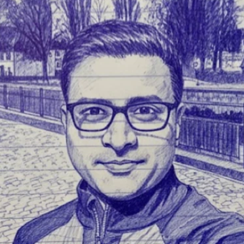

{.avatar fig-alt="Abhishek (Abhi) Pratap"}

*Advancing clinical research through people-centered technology.*

I'm a clinical R&D and technology leader with 15+ years of hands-on experience designing and running
clinical trials, from early and late phases through post-market (real-world) studies, that together have
enrolled 30,000+ participants.

My work spans regulatory-grade evidence generation and regulatory interactions, and developing and
embedding fit-for-purpose digital and AI technologies that speed up trial execution and measure outcomes
that matter to patients and families. I've worked hands-on from analysis of multimodal, longitudinal
clinical and real-world data to oversight of data management and FAIR data platforms for several
industry–academia consortia, and I'm now building business-centered AI agents for clinical development.

My career spans genomics, digital health, data science, AI and late-stage drug development, leading
translational research with NIH centers, industry and academia in depression, schizophrenia, Alzheimer's
and Parkinson's disease, and multiple sclerosis.

To get in touch, [contact me on LinkedIn](https://www.linkedin.com/in/abhishekpratap/).

::: {.fineprint}
Unless noted otherwise, content on this site is licensed under [CC BY-NC 4.0](https://creativecommons.org/licenses/by-nc/4.0/): you are welcome to share and adapt it for non-commercial use, including teaching and research, with credit and a link back.
:::
