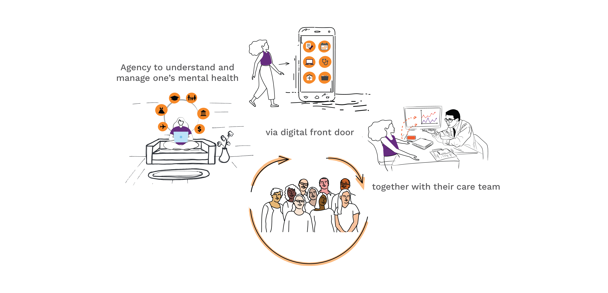
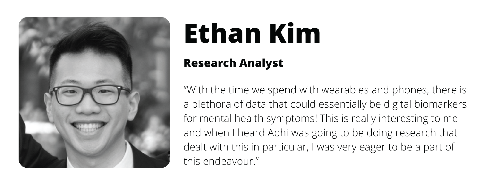
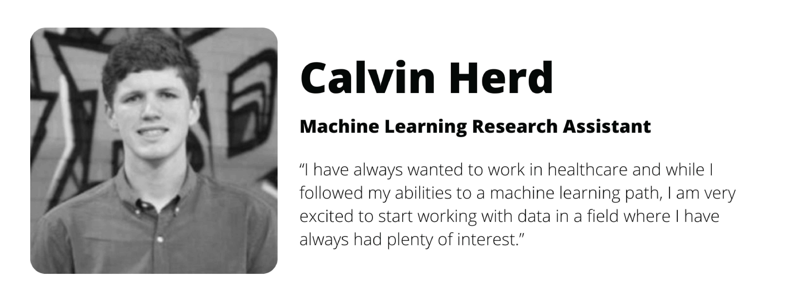
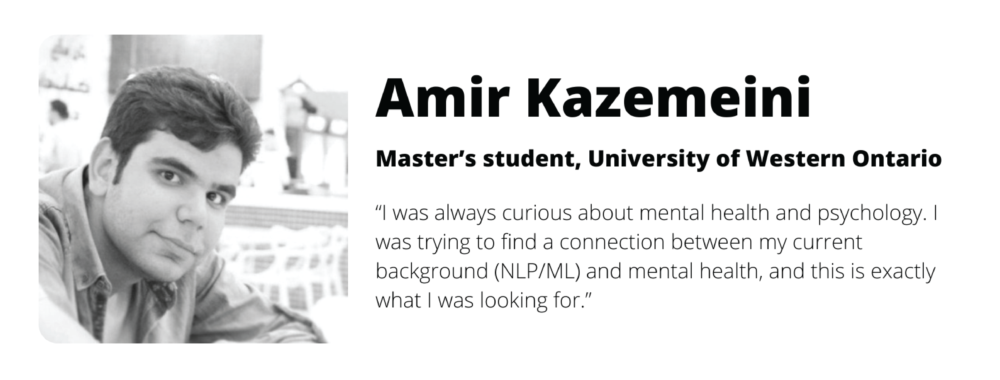
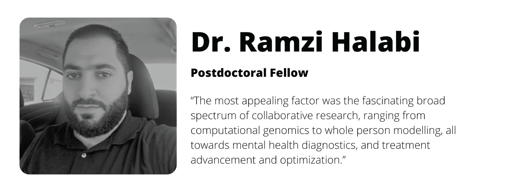
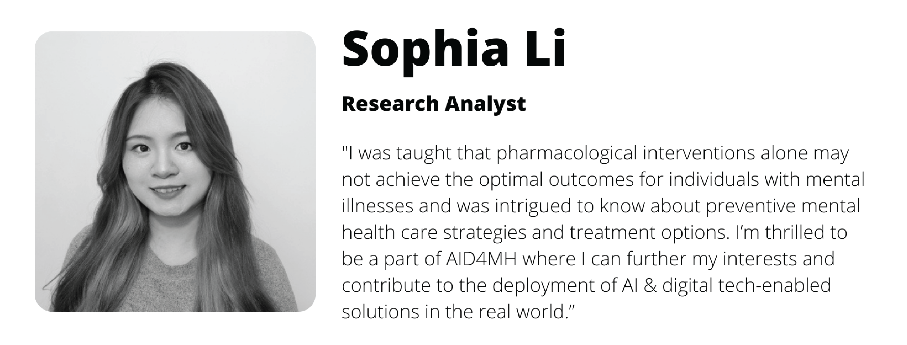
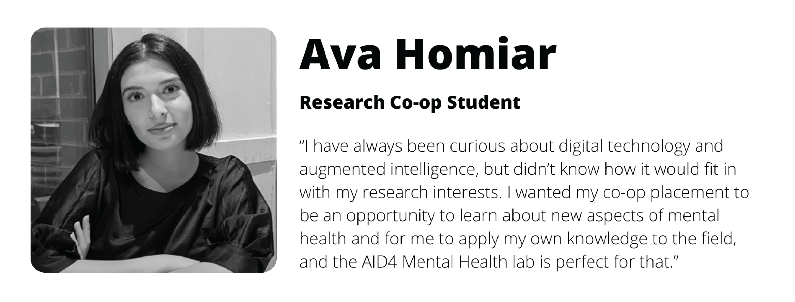
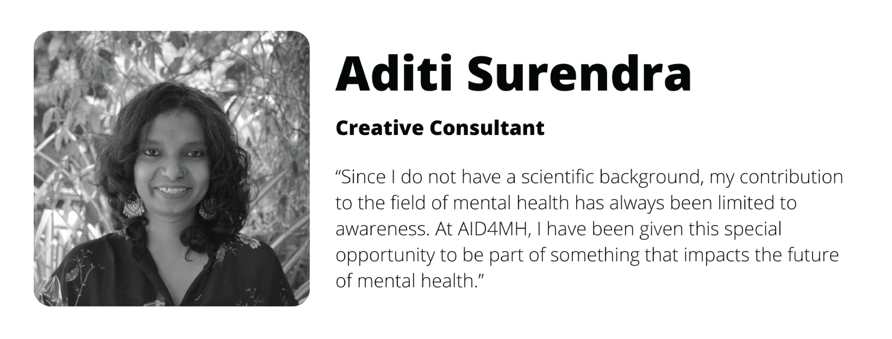
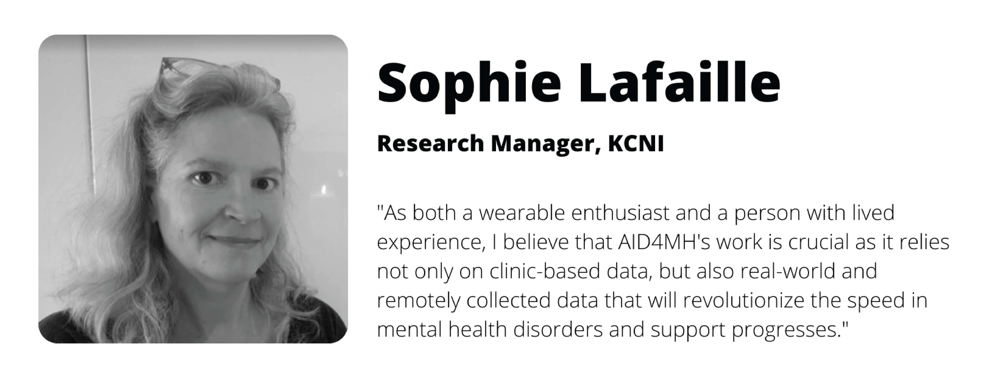



The year 2021 continues to test our resilience as we try to find a new normal of living with COVID-19. For my family too, 2021 was quite a year - from caring for our one-year-old to looking after my parents in India, as they recovered from COVID-19 - a lot transpired behind the scenes while I was drawing up the plans for the launch of this research group. 

As I sit back and reflect, there is so much to celebrate and be thankful for on account of the **launch of Augmented Intelligence & Digital Health 4 Mental Health (AID4MH)**.

{fig-alt="Illustration for the launch of the AID4MH group"}

## From the personal front

Earlier this year, I wrapped up an incredible eight-year journey at Sage Networks (and University of Washington), where I experienced some of the best moments of my professional career thus far. And the day that I was to take the plunge into the new role, my world was knocked sideways when both of my parents contracted the coronavirus during the second wave of the pandemic, back home, in India.

I left for India immediately and found myself amidst a critical health crisis - people scrambling for hospital beds and oxygen cylinders while the casualties piled up. It was the first time I saw the disparity between the world of research in the West and the pragmatic needs of people fighting the battle on the ground, especially in a place where resources were limited or stretched too thin. I saw the true extent of the privilege that so many of us have, and returned to Seattle with an immense sense of gratitude.

## To a new professional journey

From my very first visit to CAMH, I was drawn to their mission to prioritize mental health by aspiring to provide care to a diverse community digitally, beyond the limitations of clinical facilities. CAMH’s mission-driven plan to include digital mental health at the center of future research and care appealed to me. 

**My prior experience in developing digital tech for CNS-related disorders had me convinced that tech (Machine Learning (ML) or Artificial Intelligence) alone won't be sufficient to bring a sea change in current mental health research and care. The need is to develop fit-for purpose digital health solutions that provide an intrinsic value proposition to patients and providers in the real-world setting.**

And in my opinion using collaborative community models to co-design and co-create human-augmented intelligence (AI) could help fill the gap of inadequate and untimely mental healthcare. Together with the leadership at Krembil Centre for Neuroinformatics (KCNI) and CAMH, I started setting up AID4MH while physically and mentally shuttling between Delhi, Seattle and Toronto. 

## The AID4MH Team

It is with absolute pleasure that I introduce the extraordinary AID4MH team and briefly talk about some of the collaborative projects they are working on.

{fig-alt="Ethan Kim"}

Ethan has a background in lab-based neuroscience together with scientific data analysis. His research focuses on examining a variety of real-world data with a current focus on wearable data from over 5000 research participants. He is also developing [POISE](/aid4mh/projects/poise.md), a web-based application that uses an individual’s personalized online information-seeking behavior to identify behavioral trends and patterns. It is being used for the [SearchLight](/aid4mh/projects/searchlight.md) study which is exploring behavior patterns that can be used as indicators of the risk of self-harm and suicide. 

{fig-alt="Calvin Herd"}

Calvin Herd is a student at the University of Toronto. He is in the engineering science program, with a specialization in machine intelligence which involves machine learning, artificial intelligence, and data science. He is currently curating a very large real-world dataset along with the analysis of sensor data obtained from thousands of research participants. Along with other team members, he is working on developing a real-time context assessment toolkit to help researchers deploy just-in-time contextual assessment and interventions in future decentralized trials.

{fig-alt="Amir Kazemeini"}

Amir Kazemeini has a background in Natural Language Processing (NLP), particularly in using deep-language models for personality detection. He is working with a variety of mental-health-related datasets, all of which involve unstructured textual data. To do so, Amir is creating an open pipeline, [PsyLaP](/aid4mh/projects/psylap.md) – PsychoLinguistic feature Analysis Pipeline - to help clinicians and researchers learn about individual personality traits from multi-domain open text data.

{fig-alt="Dr. Ramzi Halabi"}

Dr. Halabi is currently based in Lebanon but will be joining us in Toronto in the next few months. Dr Halabi has over eight years of experience in biomedical research, an expert in biomedical signal processing. At AID4MH, he will co-lead several projects focusing on the development of end-to-end time series modeling and classification pipelines that will be deployed in clinical research and care.

{fig-alt="Sophia Li"}

Sophia recently graduated with a master’s degree in Health Informatics at the Institute of Health Policy, Management, and Evaluation, at the University of Toronto (Congratulations!). Sophia has experience in statistical data analysis related to multimodal and longitudinal datasets collected from electronic health records, patient/participant self-reported surveys, wearables, and smartphone-based sensors. She will co-lead the longitudinal data analysis of patient-reported data and also assist with the creation of dashboards, visualizations, and other resources for clinicians/collaborators to explore and leverage data and analysis results.

{fig-alt="Ava Homiar"}

Ava is a third-year life science co-op student minoring in psychology and philosophy. She is currently a research student at the Centre for Advanced Research in Experimental and Applied Linguistics at McMaster University and the Injury Prevention Research Office at St. Michael’s Hospital. At AID4MH, Ava will coordinate the management of wearables-based projects to monitor continual physiological patterns. Ava will also conduct independent research projects that assess the role of digital health technology in mental health.

{fig-alt="Aditi Surendra"}

Aditi is a writer and graphic designer and handles the creative development at AID4MH. An expert-by-experience from a non-scientific background, her forte lies in communicating complex concepts for a general audience thereby making research accessible to the end-user.

{fig-alt="Sophie Lafaille"}

Sophie is a research manager at KCNI. She is a SOCRA certified clinical research professional with over 25 years of progressive experience. Her expertise lies in research study operations, research training, research ethics, legal contracts, research HR & CAMH P&E, financial management, grant review and applications, adhering to and meeting REB, QA and regulatory requirements. Sophie’s amazing administrative experience along with project management skills is what keeps  the day-to-day operations at AID4MH group smooth and efficient.

**I am thrilled to have such an amazing and diverse team on board. We are eager to start the new year so, together, we can co-create effective digital mental health solutions and look forward to sharing our progress. We believe it will take a transparent and collaborative community model to develop tech augmented solutions that make a difference in assessing and improving individuals’ mental health. Let us hope for a safer new year that opens more opportunities for collaborations among researchers, participants/patients, providers, storytellers, and data scientists. Happy holidays.**
