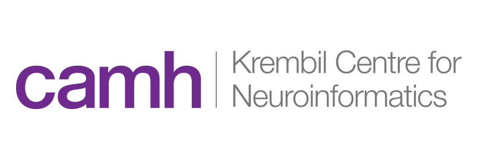
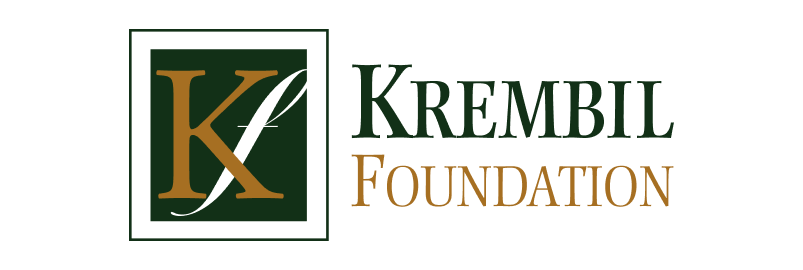
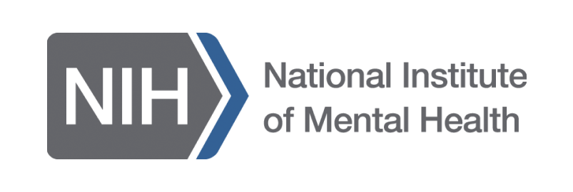



<!-- The old site showed only these logos here; add collaborator names and grants as needed. -->

::: {.logo-strip}
{fig-alt="CAMH Krembil Centre for Neuroinformatics"}
{fig-alt="NSF"}
{fig-alt="Krembil Foundation"}
{fig-alt="NIH NIMH"}
:::
