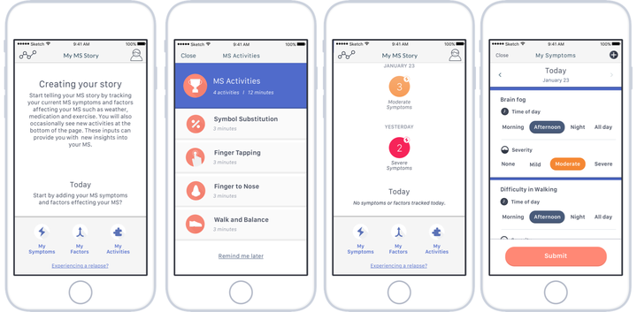



{width="80%" fig-align="center" fig-alt="Featured image from the elevateMS study paper in JMIR"}

## Abstract
### Introduction

Increasingly ubiquitous and affordable, wearables have great potential in providing fit-for-purpose solutions for promoting children’s overall health and well-being. With multimodal physiological sensing capabilities, these devices offer researchers and families an opportunity to monitor and help improve real-world behavior, physical fitness, etc., in children.

The Adolescent Brain Cognitive Development (ABCD) Study is the most extensive ongoing prospective observational study of brain development and child health in the United States, enrolling over 11,000 adolescents who will be followed for 10 years. Amongst the multimodal longitudinal assessments to track biological and behavioral development through adolescence into young adulthood, researchers also deployed wearables (Fitbit Charge HR 2) to collect real-world physical activity and sleep data. 

However, limited research is available about factors and temporal behavior patterns that may be impacting the quality of passive data collected through wearables in children in remote settings. The present study aims to quantify specific cohort characteristics that lead to biased wearable data collection, severely impacting the robustness and generalizability of inference learned from the collected data. 

### Methods

Overall ABCD cohort (N=11,878) was divided into two sub-cohorts: children who opted for Fitbits (FT) and those who did not (non-FT). The physiological data (heart rate, sleep, etc.) collected from Fitbit wearable and associated data quality features were obtained from the ABCD Study data portal. These features quantified data quality such as minutes excluded from the total minutes of physical activity or sleep due to i) missing heart rate (HR) data, ii) HR values < 50, and iii) transient invariance in HR signal, etc. To assess the compliance and quality of data, we used the maximum common observation period of 21 days. We used an unsupervised hierarchical clustering approach to discover latent temporal patterns in each data feature. The optimal number of clusters was selected using the Elbow method. Participants’ characteristics across clusters were examined through Chi-Squared and Kruskal-Wallis tests for categorical and continuous data, respectively.

### Results

Of the total children enrolled in the study, wearable data was available from 5,770 children (48.6%), and of these, sleep and physical activity data were available for 4508 children (78.1%, 4508/5770). Statistically significant sociodemographic differences were seen between FT and non-FT cohorts.  White-identifying children were overrepresented (+12.6%, p<.001) in the FT vs. the non-FT cohort.  However, children identifying as Black/African-American were significantly underrepresented (-8.5%, p<0.001) in the FT cohort compared to those in the non-FT. The sociodemographics of the parents also showed statistically significant differences (p<.001) across the FT and non-FT cohorts: a higher proportion of parents of children in the FT cohort were married than those in the non-FT cohort (+8%), employed full time (+5.1%) and attained an undergraduate degree (+5.9%).  

Marked differences in the density and quality of temporal data obtained from Fitbits were seen within the FT cohort.  White-identifying children, on average, not only contributed significantly more data (medium number of minutes worn: +13,205, p<0.001) but also shared higher quality data (median number of minutes of low-quality data excluded: -5808.5, p<0.001) compared to Black/African-American-identifying children.  The median wear time was significantly higher in participants who shared higher quality Fitbit data (18 days) compared to the group with lower data quality (8 days). Additionally, statistically significant differences (p<0.001) in the parents’ marital status (+13%) and employment status (+3.2%), among other variables, were also observed between the groups with higher quality Fitbit data vs. the rest.

### Conclusions

Our research findings show bias in the real-world wearable data collected from the children participating in the ABCD Study. The quality and quantity of the data are significantly different between White- and Black/African-American-identifying youth. If not addressed and adjusted for, these significant underlying differences in the quality of wearable data could negatively impact the personalized health trajectories learned using machine learning algorithms. Future decentralized studies could proactively monitor data streaming from wearables to detect data quality issues in real-time. Automated signal processing techniques could help triage participants sharing no or lower-quality data with human-in-the-loop interventions deployed to help improve data quality and reduce the presence of potential biases.
