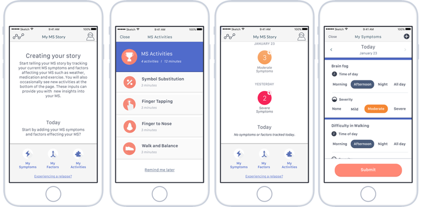



::: {.pub-links}
[PDF](https://mhealth.jmir.org/2020/10/e22108/PDF){.btn .btn-outline-primary .btn-sm} [Dataset](http://synapse.org/elevateMS){.btn .btn-outline-primary .btn-sm} [DOI](https://doi.org/10.2196/22108){.btn .btn-outline-primary .btn-sm}
:::

{width="80%" fig-align="center" fig-alt="Featured image from the elevateMS study paper in JMIR"}

## Abstract
Multiple sclerosis (MS) is a chronic neurodegenerative disease. Current monitoring practices predominantly rely on brief and infrequent assessments, which may not be representative of the real-world patient experience. Smartphone technology provides an opportunity to assess people’s daily-lived experience of MS on a frequent, regular basis outside of episodic clinical evaluations. The objectives of this study were to evaluate the feasibility and utility of capturing real-world MS-related health data remotely using a smartphone app, “elevateMS,” to investigate the associations between self-reported MS severity and sensor-based active functional tests measurements, and the impact of local weather conditions on disease burden.
