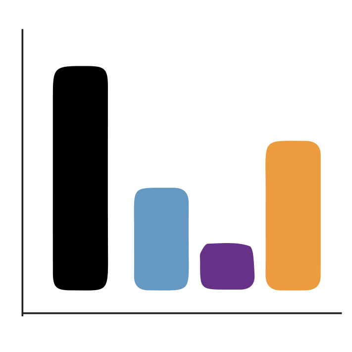
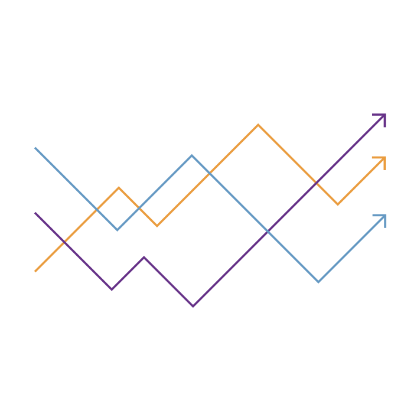
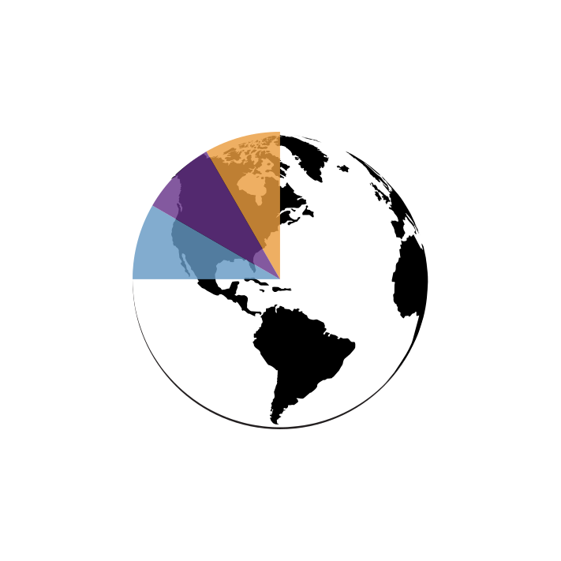
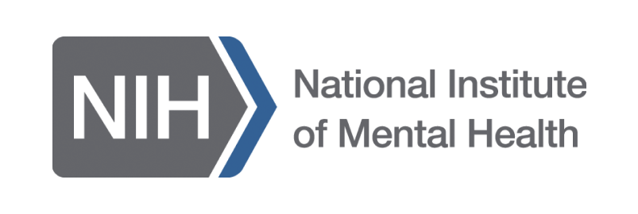



[[research summary](research-summary.qmd) · [projects](projects/index.qmd) · [team](team.qmd) · [our purpose](our-purpose.qmd) · [our culture](our-culture.qmd) · [collaborators and funding](collaborators-and-funding.qmd) · [blog](blog/index.qmd)]{.label-links}

We are unique in design, as are our lives. Be it sleep and exercise, or occupation and recreation,
we have our own blend of day-to-day experiences. And every one of these little things we do has an
impact on our mental health.

**At AID 4 Mental Health lab**, we focus on understanding the individualized real-world experience of
mental health by developing people-centered AI & digital tech-enabled solutions. We also assess ways in
which technology can be optimally deployed in the real world, that is what works for
**whom, when and for how long.**

**AID 4 Mental Health** is a not-for-profit research lab at Krembil Center for Neuroinformatics at The
Centre for Addiction and Mental Health (CAMH) in Toronto.

[Research summary →](research-summary.qmd)

## Key research areas

::: {.grid}
::: {.g-col-12 .g-col-md-6}
{width=64px fig-alt="Digital biomarkers icon"}

**[Digital biomarkers](research-summary.qmd#digital-biomarkers)**\
Development of novel clinical-grade digital biomarkers of real-world symptoms, severity and triggers of mental health.
:::

::: {.g-col-12 .g-col-md-6}
{width=64px fig-alt="Personalized health trajectories icon"}

**[Personalized health trajectories](research-summary.qmd#personalized-health-trajectories)**\
Understand how an individuals’ unique day-to-day experience can help inform their mental health care and management.
:::

::: {.g-col-12 .g-col-md-6}
{width=64px fig-alt="Bias in digital mental health icon"}

**[Bias in digital mental health](research-summary.qmd#bias-in-digital-mental-health)**\
Quantify how biases due to digital divide, lack of diversity and data privacy could impact the future of inclusive digital mental health.
:::

::: {.g-col-12 .g-col-md-6}
{width=64px fig-alt="Clinical utility of AI and technology icon"}

**[Clinical utility of AI and Tech](research-summary.qmd#clinical-utility-of-ai-and-tech)**\
Explore the modular ecosystem needed for using AI-informed workflows in mental health care, including open standards for integrating real world data into electronic health records.
:::
:::

## Research highlights

::: {#highlights}
:::

## Our funders

::: {.logo-strip}
{fig-alt="CAMH Krembil Centre for Neuroinformatics"}
{fig-alt="NSF"}
{fig-alt="Krembil Foundation"}
{fig-alt="NIH NIMH"}
:::
