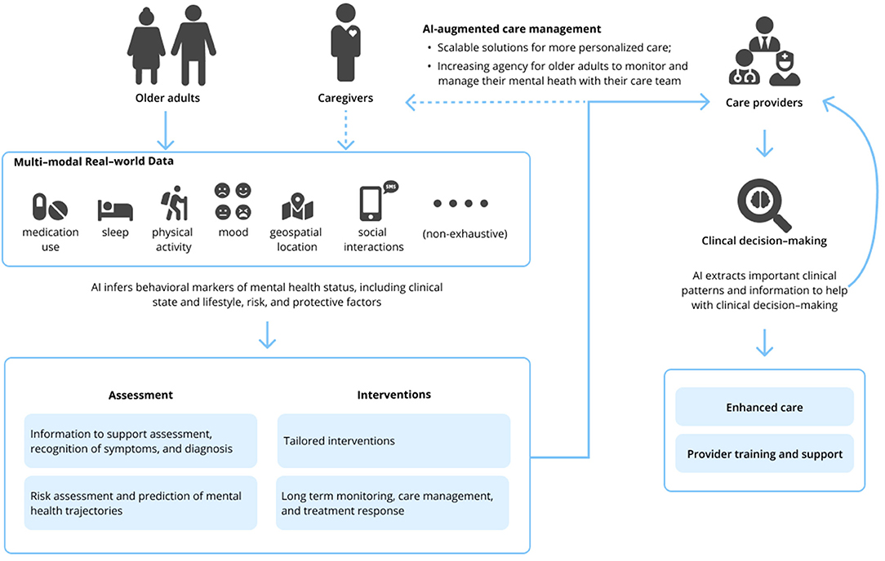



::: {.pub-links}
[PDF](https://www.frontiersin.org/articles/10.3389/fpsyt.2021.734909/pdf){.btn .btn-outline-primary .btn-sm} [DOI](https://doi.org/10.3389/fpsyt.2021.734909){.btn .btn-outline-primary .btn-sm}
:::

{width="80%" fig-align="center" fig-alt="Cover image of the Frontiers perspective on AI and machine learning in geriatric mental health"}

## Abstract
Artificial intelligence (AI) in healthcare aims to learn patterns in large multimodal datasets within and across individuals. These patterns may either improve understanding of current clinical status or predict a future outcome. AI holds the potential to revolutionize geriatric mental health care and research by supporting diagnosis, treatment, and clinical decision-making. However, much of this momentum is driven by data and computer scientists and engineers and runs the risk of being disconnected from pragmatic issues in clinical practice. This interprofessional perspective bridges the experiences of clinical scientists and data science. We provide a brief overview of AI with the main focus on possible applications and challenges of using AI-based approaches for research and clinical care in geriatric mental health. We suggest future AI applications in geriatric mental health consider pragmatic considerations of clinical practice, methodological differences between data and clinical science, and address issues of ethics, privacy, and trust.
