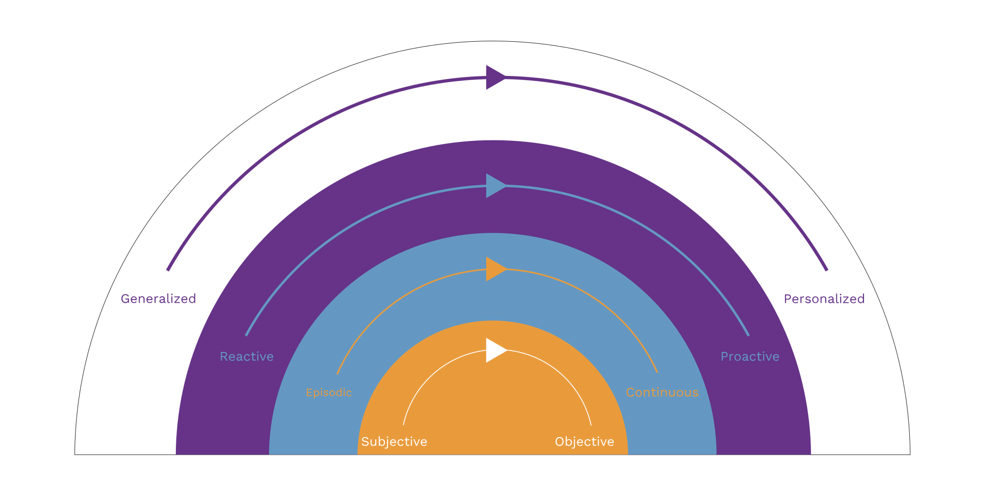



> Let no one deceive himself: trying to understand another human being’s emotional life is fraught with potential error … As intuition is greatly influenced by one’s own prejudices and needs, it lends an air of deceptive yet powerful plausibility. This is especially worrying as we have no objective yardstick for this confidence.

These words were penned by Emil Kraepelin, an influential German psychiatrist in 1920 in his essay, [The Manifestation of Insanity](https://journals.sagepub.com/doi/10.1177/0957154X9200301207). Nearly a century later, it unfortunately still holds true. We are yet to find a truly objective method that can give us a wide and steady perspective of a person’s internal, emotional and mental health.

We at AID4MH are driven by this void. Through our research, we aim to transform the way we assess and treat mental health.

### Our goal is to improve the efficacy of mental health assessment and offer more personalized treatment options.
