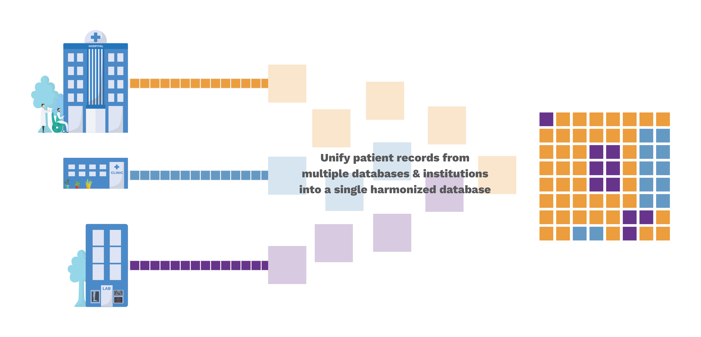



Machine learning/AI methods require large, diverse, and multimodal sources of real-world health data to infer patterns and long-term health trajectories.

However, patients’ healthcare data is likely to be scattered across many different systems at all the clinics, hospitals, and labs that they’ve visited. And to compile real-world health information from a large and diverse target population for research can require a lot of resources and time. 

The Biomed community is addressing EHR data interoperability, integration, and analytical challenges by developing health data standards, of which two - [Fast Healthcare Interoperability Resources (FHIR)](https://www.hl7.org/implement/standards/product_brief.cfm?product_id=491) and [Observational Medical Outcomes Partnership's (OMOP) - Common Data Model (CDM)](https://www.ohdsi.org/data-standardization/the-common-data-model/), have gained popularity.

Briefly, FHIR standard data allows seamless exchange of medical data from EHR’s including adding custom data/formats. The protocol aims to facilitate information sharing between different databases, such as EHRs (electronic health records), PHRs (professional health records), payer systems, and personal medical devices. The higher purpose of FHIR is to improve healthcare delivery by improving access to relevant patient data.

OMOP is a standard to harmonize and integrate disparate health information that may be present in multiple databases within and across institutions into a unified common data model (CDM). For example, it can help query and create study cohorts - ‘women aged between 18-25 who were prescribed an antidepressant at first visit’.

{fig-alt="Infographic of the eTOC project"}

The primary objective of this project is to develop a real-time data translation layer that can convert in-house EHR data to OMOP-CDM format. Once translated, we aim to have the enterprise EHR data at CAMH in FHIR and OMOP formats.  

We want to leverage a growing ecosystem of analytical frameworks that utilize harmonized EHR data to aid in the discovery of personalized mental health trajectories.  

<!-- ## Abstract {.pub-title} -->
