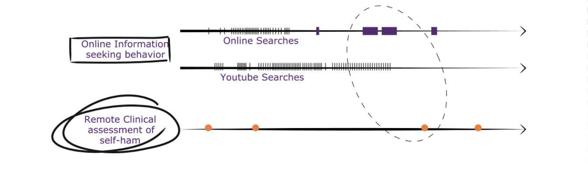
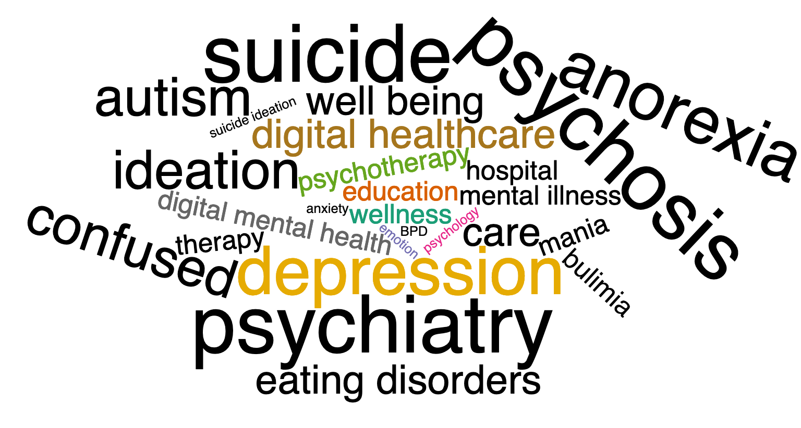
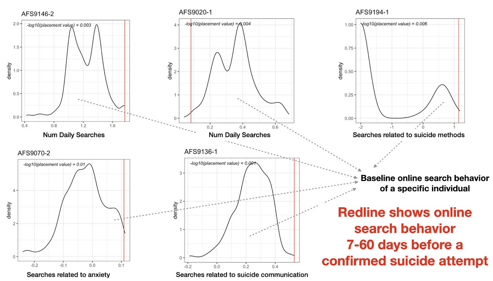



[3.97](https://www.statista.com/topics/1145/internet-usage-worldwide/#dossierKeyfigures) billion people across the world use the internet. And every one of those users has a digital footprint that consists of their social media activity, their entertainment preferences, and their online information-seeking behavior. People’s online search behavior may serve as a continual source of real-world behavioural data for mental health research. While an individual search like “How do I remove an ink stain” may not reveal a lot, the overall search history can uncover trends and patterns that may provide valuable and personalized insights about their internal state of mind.

POISE, short for **P**ersonalized **O**nline **I**nformation **S**eeking **E**xplorer, is a web-based application, to help researchers explore participants' online information-seeking behaviour by observing their online search history in a secure and privacy-preserving manner. 

An individual’s search data can offer a day-to-day glimpse of the user’s search activity - the key topics, the time of day, and frequency of use. The goal is to gather insights related to behaviour changes using a person’s online search behavior. Such behavioral patterns may help identify novel risk factors related to mental health and guide the large-scale deployment of early-stage interventions in real-world settings.

The first use case of POISE emerged from data collected as part of a [recent study](https://www.jmir.org/2021/5/e27918). Our team used Google search histories to observe patterns related to suicidal ideation. The participants consented to provide their online search data around the time of their suicidal attempts. The analysis revealed distinctive online information-seeking behavior across individuals.

POISE will initially be available to the study team and partners at the [University of Washington](https://www.washington.edu/) and the [The Centre for Addiction and Mental Health](https://www.camh.ca/) (CAMH). However, our long-term goal is to offer broader access to POISE to enable individuals to examine their own search data and understand their own patterns. We take data privacy and security seriously. Users will be able to visualize patterns in their online search data through POISE without the need to upload the data on our servers.

<!-- ## Abstract {.pub-title} -->
