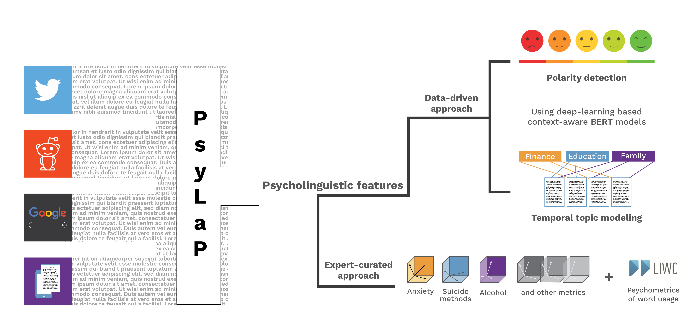



Whether it’s a short tweet or a detailed blog post, the internet has become the primary outlet for expression. From large publicly available conversational datasets - tweets, Reddit threads, to private and personalized digital diaries, online information seeking (e.g. Google searches), the real-world continual sources of data streams provide rich contextual and near-real time data for researchers to study [human behavior](https://www.openaccessgovernment.org/social-media-data/113292/) and social systems including [mental health](https://dl.acm.org/doi/abs/10.1145/2464464.2464480).

Our aim in building PsyLaP is to understand the key psycholinguistic features (e.g sentiment, key semantic meanings, etc.) expressed by individuals in free real-world text data using a combination of various state-of-the-art natural-language-processing (NLP) methods. For example, finding time in/variant patterns (sentiment, key topics mentioned) related to an individual’s personality and assessing how they could be predictive of long-term mental health outcomes (e.g individualized risk and protective factors related to anxiety, mood etc).

We are building PsyLap, an independent multi-dimensional feature extraction pipeline that can be used for research projects that rely on unstructured textual data. The pipeline will be capable of mapping open text (tweets, online searches etc) to psychosocial constructs such as affect, cognition using a combination of data driven and expert-curated approaches etc.

During the development phase, we are using PsyLaP across multiple research projects: SearchLight and POISE study personalized online search data of people dealing with suicidal thoughts; and SleepHealth examines morning and evening journals to find patterns (symptoms, triggers) that impact sleep quality.

PsyLaP has the potential to assist biomedical researchers in extracting context from open textual data to gain insight into the underlying emotional and mental state of an individual.

<!-- ## Abstract {.pub-title} -->
