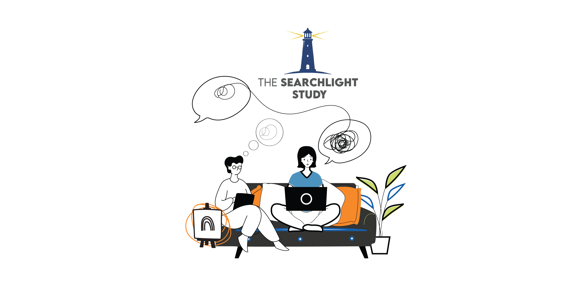
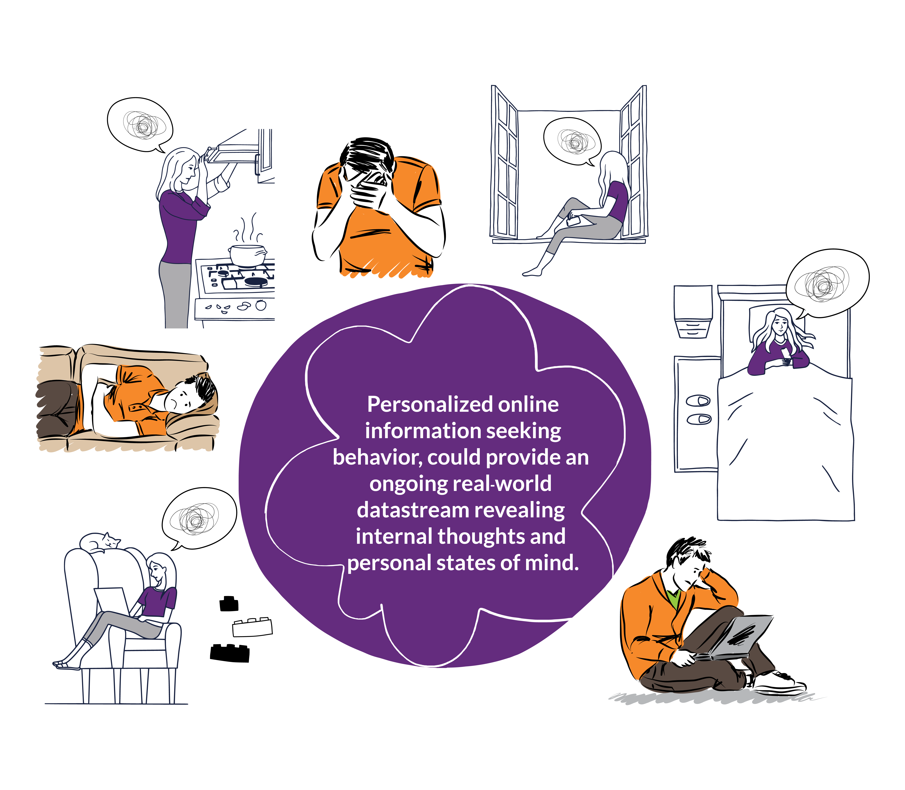
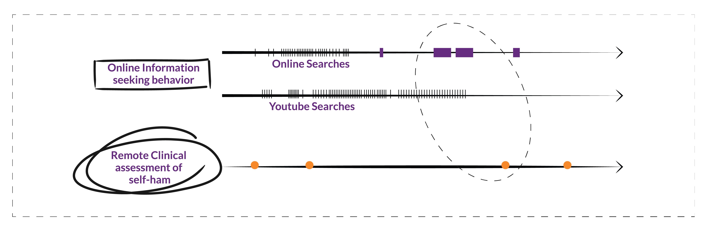



{fig-alt="two people looking at digital devices on a couch"}

[700,000](https://www.who.int/news-room/fact-sheets/detail/suicide) people die from suicide worldwide each year. The number of people who attempt suicide is much more, and often undocumented. On average, it takes between 11 to 25 nonfatal attempts before a death by suicide occurs.

A [report in 2019](https://afsp.org/suicide-statistics/) showed that while men die by suicide three times more often than women, women were more likely to attempt suicide. 90% of people who died by suicide had a diagnosable mental health condition at the time of their death.

However, over 50 years of [research](https://pubmed.ncbi.nlm.nih.gov/27841450/) has shown limited success in preventing suicide. Perhaps one of the reasons is **a focus on identifying “who” is at risk but not “when” they are at the highest risk of self-harm.**

The SearchLight Study aims to gather the internal thoughts and state of mind of an individual at risk by studying their personal online seeking behavior. 

{fig-alt="Picture reads, Personalized online information seeking behavior could provide an ongoing real-world datastream revealing internal thoughts and personal states of mind."}

This is accomplished by observing an individual’s online web searches, on Google and YouTube for example, and analyzing them along with a timeline of their past self-harm behavior. 

{fig-alt="Diagram describing frequency of online searching"}

We believe analyzing individuals’ online information seeking behavior could reveal novel insights about real-world personalized risk factors and when someone may be at a higher risk of self-harm. 

To enable secure and fully remote collection of search data from consented participants, we have developed a web-based application that will be available to the research community.

To learn more about this ongoing study, visit the [Searchlight Study website](http://www.searchlightstudy.org) or view a short informational video on [YouTube.](https://www.youtube.com/watch?v=hxT3LJyXKjA).

{fig-alt="Study is partnered with the University of Washington, the UW Creativ Lab, CSPAR, The Centre for Addiction and Mental Health, and is funded by the National Institute of Mental Health."}
