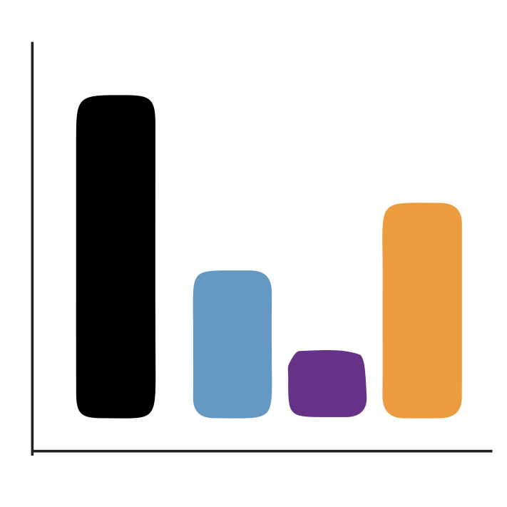
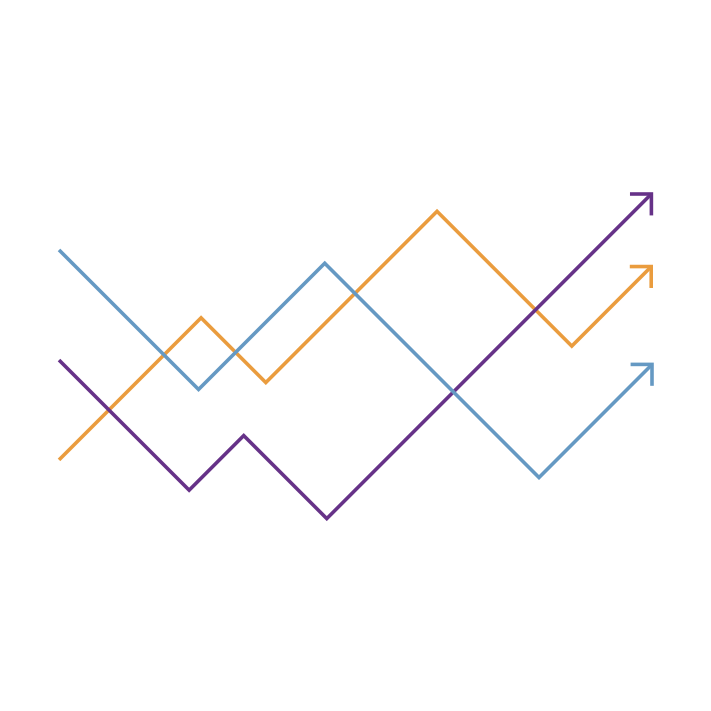



The shortcomings in mental healthcare are a global concern, affecting 1 out of 2 people in developed nations and 4 out of 5 in developing [countries](https://www.nature.com/news/polopoly_fs/1.19694!/menu/main/topColumns/topLeftColumn/pdf/532020a.pdf?origin=ppub).  The treatment gap is wide. The care is inadequate due to resources being stretched out too thin and the intervention is often too late.

Even when patients are able to access appropriate care, diagnosing mental health disorders can often be imprecise: Two clinicians may diagnose the same patient differently, and people with the same diagnosis may also be of different genetic and socio-demographic backgrounds, experience different symptoms and behaviors, and have very different lives. 

Traditional clinical studies fail to provide a comprehensive perspective of a patient’s life, often relying on short and episodic clinical visits to assess mental health. Therefore, the looking glass only offers a glimpse as opposed to a bird’s eye view of the patient’s day-to-day lived experience.

Today, a wealth of information can be collected using smartphones and wearables, that can offer a much wider perspective of a patient's day-to-day behavior. Clinicians and researchers can access data on sleep, nutrition, social, occupational, and physical activity levels, and other variables that impact mental health. The resulting insights can be used to understand the diversity of individuals in the context of everyday behavior. It can lay the foundation for personalized measurement-based health care and other scalable people-centric solutions.

**At AID 4 Mental Health lab**, we focus on understanding the individualized real-world experience of mental health by developing people-augmented digital health solutions and assess optimal ways in which technology can be deployed in the real world — **that is what works for whom, when and for how long.**

### Our Focus Areas of Research
### Digital biomarkers

{width=72px fig-alt="Digital biomarkers icon"}

*Development of novel clinical-grade digital biomarkers of real-world symptoms, severity, and triggers of mental health.*

We aim to enable a transition in mental health towards a [measurement-based-approach](https://www.ncbi.nlm.nih.gov/pmc/articles/PMC4910387/).  Our research will focus on the development, verification, and validation of [fit-for-purpose](https://www.ncbi.nlm.nih.gov/books/NBK540105/) real-world digital endpoints that can capture symptoms, severity, and triggers of mental health conditions for individuals.

The high-frequency [real-world](https://www.fda.gov/science-research/science-and-research-special-topics/real-world-evidence) data can provide new ways to capture the individualized day-to-day experience of people in an objective, momentary and nonreactive way.  Real-world data can also offer a clearer perspective on the distinctive experience of each patient. The data can outline the variability of their symptoms, triggers, and treatment response along with the impact of external factors on biological systems, translated through neural and developmental processes. 

### Personalized health trajectories

{width=72px fig-alt="Personalized health trajectories icon"}

*Understand how an individuals’ unique day-to-day experience can help inform their mental health care and management*

Research has shown that the current [DSM](https://www.psychiatry.org/psychiatrists/practice/dsm)-based diagnoses and clinical nosology of Mental Health Disorders (MHD) can be ineffective in the accurate and timely detection of mental health conditions. Additionally, the individualized manifestation of MHD-related symptoms and severity leads to a high degree of heterogeneity in diagnosis and treatment response. 

Today, we see an increase in the volume, variety, and velocity at which we can gather mental health-related real-world data digitally. This has created a new need-of-the-hour, to establish analytical approaches that can learn about an individual's context and predict the best possible ways to monitor and mediate in a timely manner. 

AID4MH lab will focus on developing human-augmented machine learning and artificial intelligence-based workflows.  Our aim is to deliver pragmatic digital health solutions for real-world clinical implementation while keeping the best interests of the people at the center of our analytical research.  

In essence, our goal is to understand what and how real-world risk and protective factors impact people’s mental health. We want to generate individualized health trajectories with the help of [deep phenotyping](https://pubmed.ncbi.nlm.nih.gov/22504886/) coupled with [N-of-1](https://www.ncbi.nlm.nih.gov/pmc/articles/PMC3118090/) analytical approaches. We strive to define the operational bounds of analytical workflows, balancing between acting upon data-driven insight and refraining in cases of limited data.

### Bias in digital mental health

{width=72px fig-alt="Bias in digital mental health icon"}

*Quantify how biases due to the digital divide, lack of diversity, and data privacy could impact the future of inclusive digital mental health*

Building digital health technology to assess and mediate in mental health is not sufficient by itself. Its success will also depend on the technology’s acceptance and adoption by various stakeholders.  These include, but are not limited to, care providers, patients, caregivers, and particularly the at-risk, marginalized, and ethnic minorities.   

Our recent [work](https://www.nature.com/articles/s41746-020-0224-8) has shown that the ongoing bias in participant recruitment combined with inequitable long-term participation can severely impact the generalizability of real-world evidence. Left unchecked, we risk undermining the potential of the scope of digital health. 

In order to build equitable and inclusive digital mental health solutions, we need to expand our understanding of deploying technology in the real world. We need to identify not just what works, but also who they work for. We need to account for the possible impact on generalizability— if the concerns and data from certain populations are not addressed and included respectively. 

At AID4MH lab, we are interested in quantifying potential biases in digital health solutions, particularly in fully remote decentralized studies and clinical trials. We develop methods to learn and correct potential confounding in the real-world data to ultimately generate robust and generalizable insights. Additionally, we create strategies to help improve cohort diversity and long-term engagement in remote studies by working closely with patients, families, and providers.

### Clinical utility of AI and Tech

{width=72px fig-alt="Clinical utility of AI and technology icon"}

*Explore the modular ecosystem needed for using AI-informed workflows in mental health care, including open standards for integrating real-world data into electronic health records*

Technology-enabled services have the capacity to bridge the gap in mental healthcare. However,  further research and multi-stakeholder engagement is required to accelerate digital psychiatry research beyond pilots and generate clinically actionable and replicable insights.

To accomplish this, we need to establish participant-centered data collection frameworks and standards for data and meta-data integration, as well as the secure exchange of information. 

At AID4MH, we work closely with diverse stakeholders (academia, pharma, federal and regional and regulatory agencies) to help create and expand on existing open-source efforts, best-practices for sharing and exchange of data using standardized, secure, and [privacy-preserving](https://www.nature.com/articles/s42256-020-0186-1) approaches.
