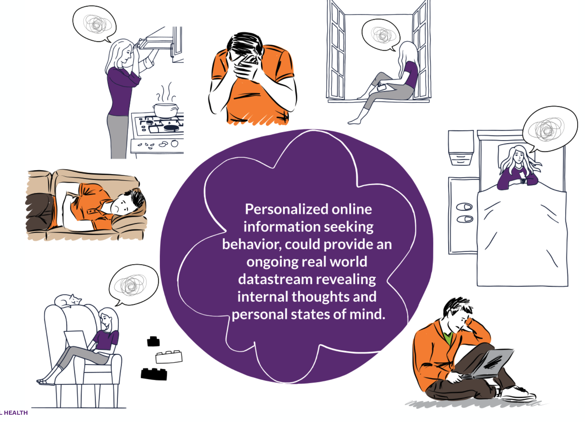



::: {.pub-links}
[Slides](https://filedn.com/l4tGgxWLEWeBj6LvlhtwCYF/PPTs/202110_TIPS_Blitz_Talk.pdf){.btn .btn-outline-primary .btn-sm} [TIPS-2021](https://home.mcleanhospital.org/tips#agenda){.btn .btn-outline-primary .btn-sm}
:::

{width="80%" fig-align="center" fig-alt="Title slide of the TIPS 2021 talk on the SearchLight study"}

## Abstract
Suicide continues to be among the top 10 leading causes of death in the US.  Despite decades of research, our ability to predict when someone might be at the highest risk of self-harm suicide has not significantly improved.  Personalized social media and online search history data, by contrast, could provide an ongoing real-world datastream revealing internal thoughts and personal states of mind. 

We conducted this study to determine the feasibility and acceptability of using personalized online information-seeking behavior in the identification of risk for suicide attempts. A total of 62 participants who had attempted suicide in the past agreed to participate in the study. Changes in online search behavior proximal to suicide attempts were evident up to 60 days before the attempt. The top 3 search constructs associated with attempts were online searching patterns, semantic relatedness of search queries to suicide methods, and anger. Participants (68%) indicated that use of this personalized web search data for prevention purposes was acceptable with noninvasive potential interventions such as connection to a real person (eg, friend, family member, or counselor); however, concerns were raised about detection accuracy, privacy, and the potential for overly invasive intervention. 

Using AI-based analytical approaches applied to real-world online information-seeking behavior could offer an unparalleled opportunity for researchers to understand the novel and proximal risk factors associated with an individual’s underlying thoughts of killing themselves and potentially provide an early intervention opportunity.
