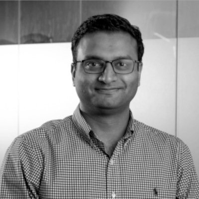
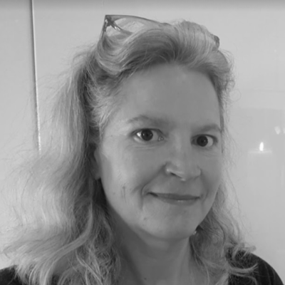
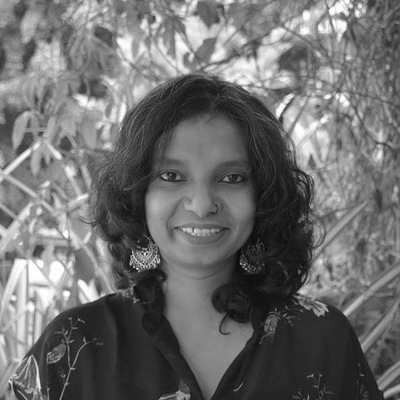
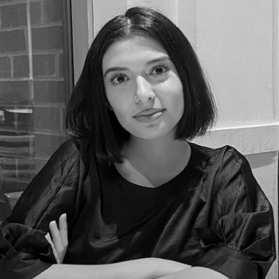
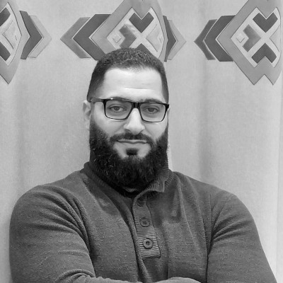
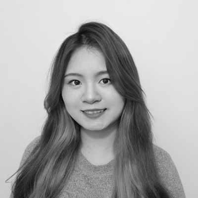
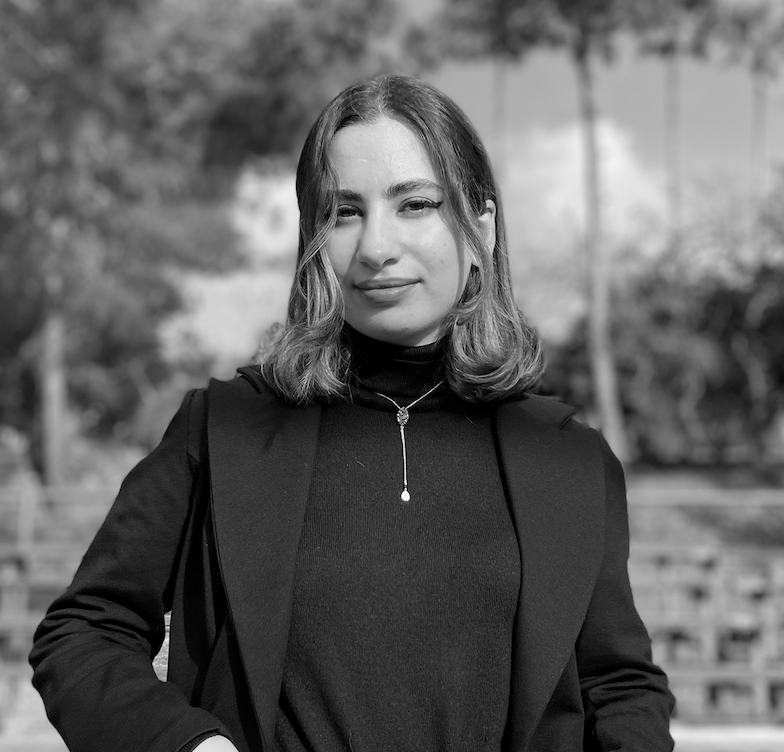



<!-- Generated from the old site's data/team.json. Edit freely. -->

::: {.grid}
::: {.g-col-12 .g-col-sm-6 .g-col-md-4 .person}
{fig-alt="Abhi Pratap"}

**Abhi Pratap**

[Group Head, AID4MH]{.role}

[<a href="https://twitter.com/abhishekpratap" aria-label="twitter-x"><i class="bi bi-twitter-x"></i></a> <a href="https://github.com/apratap" aria-label="github"><i class="bi bi-github"></i></a> <a href="https://www.linkedin.com/in/abhishekpratap/" aria-label="linkedin"><i class="bi bi-linkedin"></i></a>]{.socials}
:::

::: {.g-col-12 .g-col-sm-6 .g-col-md-4 .person}

**Ethan Kim**

[Research Analyst, AID4MH]{.role}

[ <a href="https://github.com/ethanhkim" aria-label="github"><i class="bi bi-github"></i></a> <a href="https://www.linkedin.com/in/ethkim/" aria-label="linkedin"><i class="bi bi-linkedin"></i></a>]{.socials}
:::

::: {.g-col-12 .g-col-sm-6 .g-col-md-4 .person}
{fig-alt="Sophie Lafaille"}

**Sophie Lafaille**

[Research Manager, Krembil Centre for Neuroinformatics]{.role}

:::

::: {.g-col-12 .g-col-sm-6 .g-col-md-4 .person}
{fig-alt="Amir Kazemeini"}

**Amir Kazemeini**

[Master's Student, University of Western Ontario]{.role}

[<a href="https://github.com/amirmohammadkz" aria-label="github"><i class="bi bi-github"></i></a> <a href="https://www.linkedin.com/in/amirmohammadkz" aria-label="linkedin"><i class="bi bi-linkedin"></i></a> <a href="https://amirmohammadkz.github.io/" aria-label="globe"><i class="bi bi-globe"></i></a>]{.socials}
:::

::: {.g-col-12 .g-col-sm-6 .g-col-md-4 .person}
{fig-alt="Calvin Herd"}

**Calvin Herd**

[Undergraduate Student, University of Toronto]{.role}

[<a href="https://www.github.com/calvinherd" aria-label="github"><i class="bi bi-github"></i></a> <a href="https://www.linkedin.com/in/calvin-herd/" aria-label="linkedin"><i class="bi bi-linkedin"></i></a>]{.socials}
:::

::: {.g-col-12 .g-col-sm-6 .g-col-md-4 .person}
{fig-alt="Aditi Surendra"}

**Aditi Surendra**

[Creative Consultant]{.role}

[<a href="https://aditisurendra.wordpress.com/" aria-label="globe"><i class="bi bi-globe"></i></a>]{.socials}
:::

::: {.g-col-12 .g-col-sm-6 .g-col-md-4 .person}
{fig-alt="Ava Homiar"}

**Ava Homiar**

[Coop Student, McMaster University]{.role}

[<a href="https://www.linkedin.com/in/avahomiar/" aria-label="linkedin"><i class="bi bi-linkedin"></i></a>]{.socials}
:::

::: {.g-col-12 .g-col-sm-6 .g-col-md-4 .person}
{fig-alt="Ramzi Halabi"}

**Ramzi Halabi**

[Postdoctoral Fellow]{.role}

[<a href="https://www.linkedin.com/in/ramzihalabiphd/" aria-label="linkedin"><i class="bi bi-linkedin"></i></a> <a href="https://github.com/RamziHalabi" aria-label="github"><i class="bi bi-github"></i></a>]{.socials}
:::

::: {.g-col-12 .g-col-sm-6 .g-col-md-4 .person}
{fig-alt="Sophia Li"}

**Sophia Li**

[Research Analyst]{.role}

[<a href="https://www.linkedin.com/in/sophia-xueying-li/" aria-label="linkedin"><i class="bi bi-linkedin"></i></a> <a href="https://github.com/sophiiixy" aria-label="github"><i class="bi bi-github"></i></a>]{.socials}
:::

::: {.g-col-12 .g-col-sm-6 .g-col-md-4 .person}
{fig-alt="Rahavi Selvarajan"}

**Rahavi Selvarajan**

[Master's student, University of Toronto]{.role}

[<a href="https://www.linkedin.com/in/rahavi-selv/" aria-label="linkedin"><i class="bi bi-linkedin"></i></a> <a href="https://github.com/RahaviSelvarajan" aria-label="github"><i class="bi bi-github"></i></a>]{.socials}
:::

::: {.g-col-12 .g-col-sm-6 .g-col-md-4 .person}
{fig-alt="Zixiong Lin"}

**Zixiong Lin**

[Undergraduate, University of Toronto]{.role}

:::

::: {.g-col-12 .g-col-sm-6 .g-col-md-4 .person}
{fig-alt="Jana Kabrit"}

**Jana Kabrit**

[MLOps Intern]{.role}

[<a href="https://www.linkedin.com/in/jana-kabrit/" aria-label="linkedin"><i class="bi bi-linkedin"></i></a> <a href="https://www.github.com/jana-kabrit" aria-label="github"><i class="bi bi-github"></i></a>]{.socials}
:::
:::
