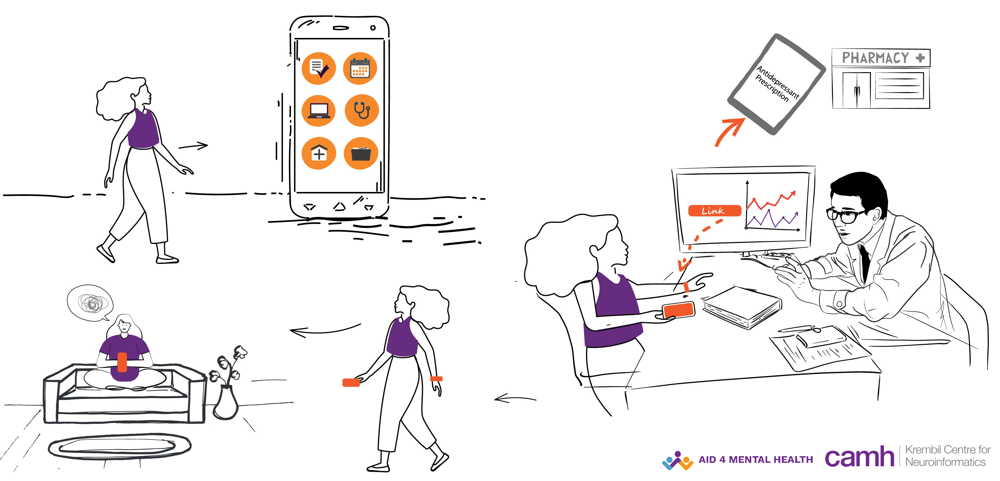
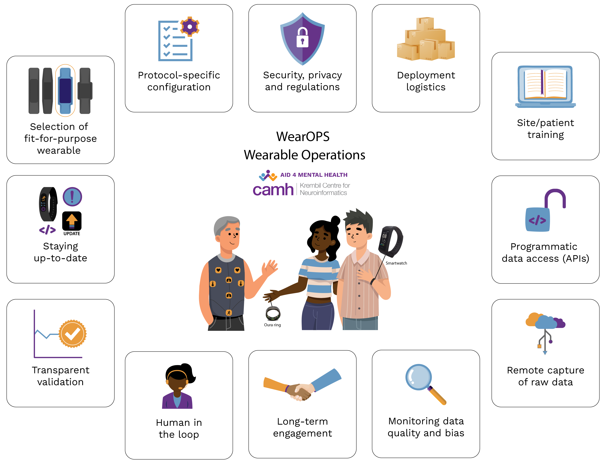

## **The opportunity**

From being named the top fitness trend of 2022 to being used to determine [Parkinsons’ symptoms](https://pubmed.ncbi.nlm.nih.gov/29059994/), wearables have penetrated the consumer market and the health care and research industry. [Smart watches dominate](https://www.alliedmarketresearch.com/smartwatch-market) the wearable market at present, however,  the form factor and biosensing capabilities of wearable devices are advancing [rapidly](https://ieeexplore.ieee.org/document/8246498) - from [smart rings](https://ouraring.com/), [smart vests](https://www.mdpi.com/1424-8220/18/7/2144), and even [smart shoes and socks](https://www.ncbi.nlm.nih.gov/labs/pmc/articles/PMC7435916/).

Increasingly democratized, wearable devices provide a [wealth of continual physiological data](https://www.himss.org/resources/wearable-technology-applications-healthcare-literature-review#_ENREF_15) such as heart rate, calories burnt, sleep patterns, temperature, blood oxygen saturation. There is growing interest in leveraging wearables in [decentralized trials](https://www.nature.com/articles/s41746-021-00473-w) to reach and recruit diverse target populations in a more efficient and less expensive manner than in traditional in-person trials

Wearable tech also enables the continual collection of real-world data (RWD) through personalized sensing in naturalistic settings. Researchers, in particular, have been exploring wearables to develop long-term health trajectories for prevention, management, and early prediction of illness1-3.

## **Wearables in Mental Health Research & Care**

Augmented with self-reported outcomes and episodic clinical data, physiological data from wearables could provide a more accurate picture of living with mental health illness (or issues). 

There is growing interest to explore the feasibility and utility of using wearable tech to monitor individual physiological responses to various psychosocial settings as people go about their daily lives. Ongoing early research has demonstrated the potential of wearable tech in mental health research and care. Some examples include wrist devices that can alleviate anxiety,  monitoring sleep, and motor data to predict crisis periods in people with depression4-5.  And by observing real-world behavior at scale, researchers could identify underlying [transdiagnostic](https://www.ncbi.nlm.nih.gov/labs/pmc/articles/PMC7027356/) signatures (e.g sleep, stress, local environment, etc) related to mental health.  Such risk factors could accumulate differentially over time in individuals leading to different lived experiences. 

> ### Our goal is to enable a transparent ecosystem for deploying wearbles in clinical research (and eventually care), to collect real-world end-points related to clinical outcomes of interest. 

## **Wearable Operations in Real-World Settings - WearOPS**

Deploying the devices (+ accompanying smartphone apps) from the research facility/clinic to participants and patients in the real world to collect high fidelity continual RWD involves many critical operational steps. 

The WearOps effort at KCNI/CAMH aims to bring the crucial stakeholders (from manufacturers, researchers, privacy experts, clinicians to participants/patients, and their families) to develop an efficient and transparent system for enabling wearable research. The WearOPS overall process ranges from selecting and configuring fit-for-purpose devices to using machine learning/artificial intelligence methods to create robust and transparently validated digital biomarkers linked to clinical outcomes of interest in a target population.  

For our initial research studies, we are focusing on the following key areas:

* **Stakeholder experience:** To ensure the smoothest possible deployment of devices to the participants and study management by research coordinators, we are developing device-specific onboarding materials. We are focusing to prioritize the participants' user experience by providing a hybrid of on-site and remote onboarding options with on-demand support available to participants

* **Privacy:** Owing to the sensitive nature of the data being shared using multiple third-party vendors, we enforce strict regulations to assure the security and confidentiality of participants’ data. Only necessary data elements will be collected, and participant data will not be shared with third parties unless consented to by the participant and required for the study. Participant accounts will be linked to non-identifiable participant IDs to ensure confidentiality, and data access will only be available to the study team. 

* **Data management:** Development of an automated workflow to download and process the lowest granularity of individual participant-level wearable data on a daily basis using a scalable time-series database. And as part of data curation, we will compute near-real-time compliance/engagement metrics for 
study participants. The system will use the wearable compliance metrics to triage participants for “human-in-the-loop” support. 

* **Bias / Engagement / Human-in-the-loop:** We recognize technology-based data collection in naturalistic settings, especially in populations facing mental health problems, could lead to biases in collected data. We aim to address this transparently and during the study design and data collection phase. We are developing a data quality monitoring workflow. The workflow will assess the potential biases in data collection in near real-time due to differential recruitment and retention. The pipeline will also triage the participants to “human-in-the-loop” support. By bringing in a study coordinator, we aim to further understand and address participants' concerns about not being able to share their data.

* **Generating Actionable Insights:** Upon wearable raw data acquisition and secure storage, transparent data validation is performed through quality assessment and control prior to any analysis. Once processed and validated, wearable sensor data is analyzed using signal processing and statistical techniques to compute data features and learn underlying patterns to serve as mental health digital biomarkers that aid in the understanding and treatment of mental illnesses. Ultimately we want to stream near-real-time data to understand significant drift in behavior at an individualized level that could trigger just-in-time contextual assessments and eventually interventions. 

## **Upcoming Projects:**

* **Major Depressive Disorder (MDD):** To assess if real-world behavior trajectories gathered through wearables could inform selection and tailoring of treatment in MDD as well as early prediction of an impending mental health crisis.

* **Substance use disorder:** Investigate the utility of moment-to-moment monitoring of physiological states in the detection of the frequency, timing, and intensity of urges and cravings of substance use, which are essential for monitoring progress through treatment programs.

* **Understanding postural changes in bipolar disorder:** Analyze and model potential postural dynamics patterns in bipolar disorder patients at different illness severity levels 

* **Assessment quality of sensor data collected in real-world settings:** We are building a pipeline to help quantitatively assess sensor data collected in naturalistic settings for correctness, consistency, completeness, and compliance. The pipeline will also quantify potential biases regarding the sociodemographic and clinical characteristics of the target population. 

***This work has been supported in part by the CAMH Foundation and the Krembil Foundation.***

References:

 1. Heintzman, N. D. (2015). A digital ecosystem of diabetes data and technology: Services, systems, and tools enabled by wearables, sensors, and apps. *Journal of Diabetes Science and Technology*, 10(1), 35–41. https://doi.org/10.1177/1932296815622453 

 2. Mason, H et al. (2022). Detection of COVID-19 using multimodal data from a wearable device: Results from the first TemPredict Study. *Scientific 
Reports*, 12(1), 1–15. https://doi.org/10.1038/s41598-022-07314-0  

 3. Rubenstein, L. Z. (2006). Falls in older people: Epidemiology, risk factors and strategies for prevention - PubMed. *Age and Ageing*, 35 Suppl 2. https://doi.org/10.1093/ageing/afl084 

 4. *“Wearable” technology for mental health*. (2020, February 27). Amelia Virtual Care. https://ameliavirtualcare.com/wearable-technology-for-mental-health/ 

 5. Lee, S., Kim, H., Park, M. J., & Jeon, H. J. (2021). Current advances in wearable devices and their sensors in patients with depression. *Frontiers in Psychiatry*, 0. https://doi.org/10.3389/fpsyt.2021.672347 
