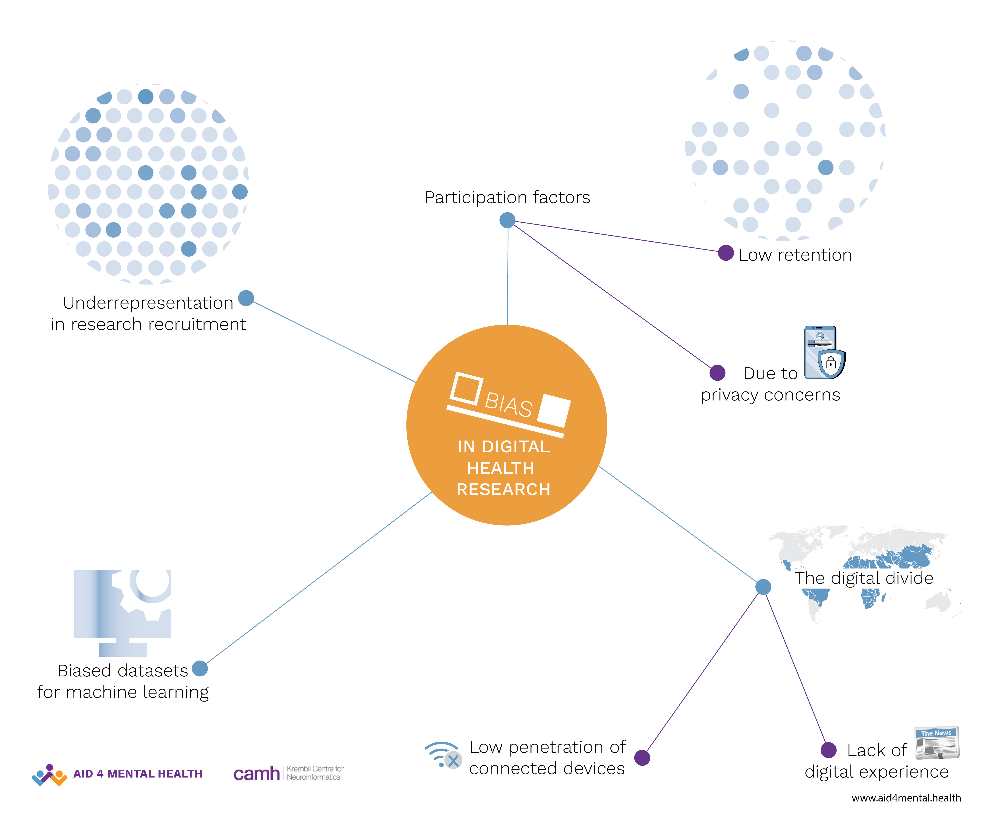
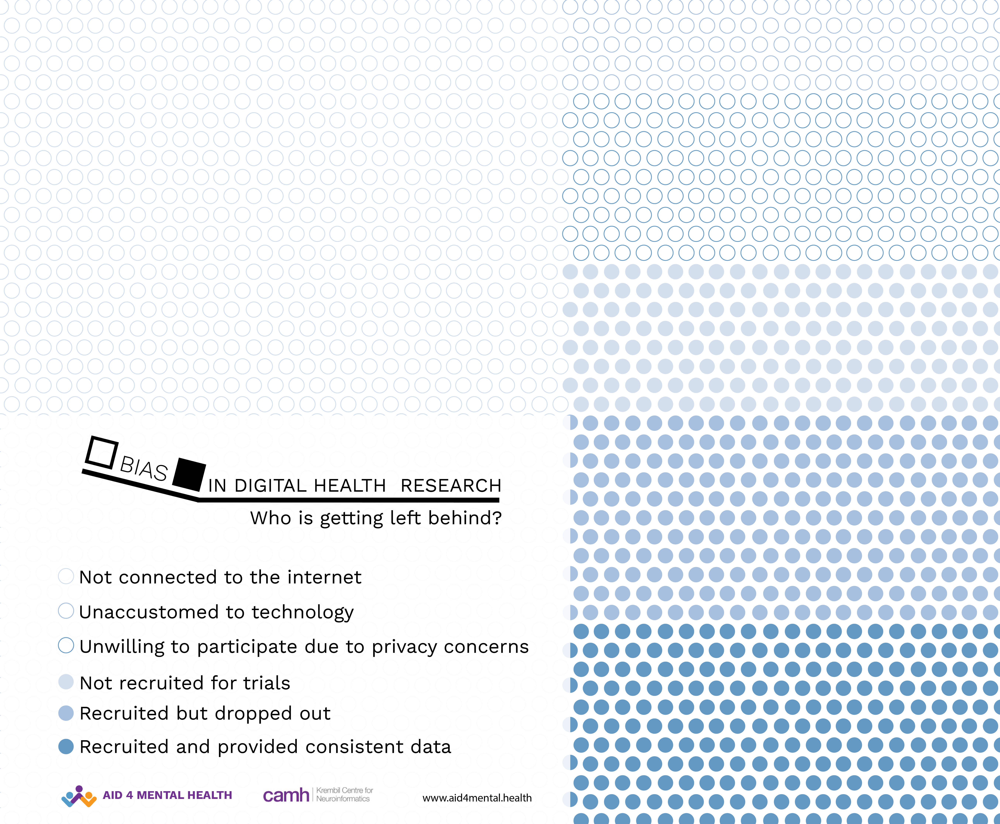

COVID-19 has unarguably brought [Digital + Health](https://www.nature.com/articles/s41591-020-1011-4) closer than ever -  powering hundreds of [digitally-augmented trials](https://beta.clinicaltrials.gov/search?patient=covid%20%20AND%20digital&locStr=&distance=0) to remote assessment and care [delivery](https://www.nejm.org/doi/full/10.1056/NEJMp2005835). However, [uniform use](https://www.ncbi.nlm.nih.gov/pmc/articles/PMC7197532/) of health tech by a diverse and representative population should not be taken for granted. 

There is a need for increased transparency - who benefits from health-tech solutions and the impact of leaving some behind - to help us build more inclusive & equitable solutions.

Here is a quick readout (admittedly biased) of what we are doing to keep [bias and equity in digital health](https://www.ncbi.nlm.nih.gov/pmc/articles/PMC7268667/) at the front and center to enable the development of equitable & inclusive people-centered digital health solutions.  

## **Digital + health research**

The growing ubiquity and ability of connected devices (e.g., [smartphones and wearables](https://www.rbccm.com/en/gib/healthcare/episode/the_healthcare_data_explosion)) to collect day-to-day lived experiences of people has gotten a lot of attention from healthcare researchers. High-frequency continual usage of smartphones allows for objective quantification of personalized daily behavior using multimodal [real-world data (RWD)](https://www.fda.gov/science-research/science-and-research-special-topics/real-world-evidence) streams.   

Through this [decentralized approach](https://www.nature.com/articles/s41746-021-00473-w), researchers can also cast a wider net and access larger and more diverse portions of the population at a fraction of the cost of traditional brick-and-mortar clinical trials. One of the key promises of RWD is to help us learn a comprehensive picture of an individual’s unique lived experience. Ultimately, the goal is to know what works and for whom to guide the development of new patient-centric treatments.

The Global South also stands to benefit from this a great deal due to regional challenges - inadequate health systems and infrastructure, [low doctor-patient ratios](https://data.worldbank.org/indicator/SH.MED.PHYS.ZS), and [expensive healthcare](https://data.oecd.org/healthres/health-spending.htm). The [rising penetration of smartphones](https://scholarworks.umass.edu/cgi/viewcontent.cgi?article=1083&context=communication_faculty_pubs) makes digital health a potentially viable solution to these challenges.

## **Beyond the Technology**

However, to expect diverse and representative use of technology for health may be delusionary, atleast in the short term. There are several real-world challenges - like the reluctance of people to participate and continue to engage and share their health-related data in decentralized research trials due to privacy concerns or the digital divide. 

{width="70%" fig-align="center" fig-alt="Illustration on bias and equity in digital health"}

There is a risk for researchers to jump at the opportunity to have this wealth of data at arm’s reach and perhaps [unintentionally overlook](https://www.rwjf.org/en/library/research/2019/10/reinventing-discovery.html) the need for stringent privacy policies. Recent [misadventures](https://cacm.acm.org/blogs/blog-cacm/226442-what-went-wrong-facebook-and-sharing-data-with-cambridge-analytica/fulltext) in data sharing could seriously [impact the willingness of people](https://jamanetwork.com/journals/jamanetworkopen/fullarticle/2755666) to participate in research that collects sensitive health-related data.

[Digital divide](https://www.himss.org/resources/digital-divide-healthcare-its-not-just-access) is another major concern - the disparity between people who are open to adapting to new technology and those who stay on the periphery, typically older and less tech-savvy people. The divide could exclude the latter from equitable representation in digital health research, making the derived learnings from such studies all the more incomprehensible to them, and so leaving them behind as the world advances.

The digital divide can also be impacted by the [difference in the rate of the population connected to the internet](https://www.thelancet.com/journals/landig/article/PIIS2589-7500(19)30111-6/fulltext) between the Global North and Global South. This poses other challenges like digital health tools not functioning properly due to lack of [internet access, low data bandwidth, varying hardware specifications, etc.](https://www.itu.int/en/ITU-D/Statistics/Dashboards/Pages/Digital-Development.aspx) 

So while going digital can prove to be an effective and scalable solution to address the massive [supply and demand gap](https://www.thelancet.com/journals/langlo/article/PIIS2214-109X(16)30190-5/fulltext) in healthcare in the Global South, we need to be more mindful in the design and development of decentralized studies to collect representative data that can inform the development of equitable health policies.

{width="70%" fig-align="center" fig-alt="Second illustration on bias and equity in digital health"}

The interplay of such real-world factors can lead to bias that may limit the impact of digital health from seeking its full potential by leaving a significant chunk of the global population behind - i.e., the less tech-savvy, the reluctant, and the disconnected. 

And bias can originate in the many stages of research, from unbalanced [recruitment](https://www.ncbi.nlm.nih.gov/pmc/articles/PMC3900086/) to differential long-term retention of the population in longitudinal studies. Underrepresentation can [make resulting outcomes inapplicable](https://academic.oup.com/sleep/article/43/10/zsaa159/5902283) to those who weren’t included in the trials and, therefore, biased. 

A well-known phenomenon is [algorithms learning bias](https://www.sciencedirect.com/science/article/pii/S2666389921002592) from datasets derived from human beings' actions and responses, which may be biased. The use of these algorithms in health tools and applications sets a dangerous precedent for the perpetuation of bias.

## **Our ongoing efforts to help address biases in digital (mental) health research**

We think there is a critical and unmet demand to explore bias in digital health research to develop long-term equitable and inclusive technology-augmented solutions. We aim to quantify these biases and develop methods to correct them to generate robust, generalizable, and, most importantly, transparent insights. We also create strategies to improve cohort diversity and boost long-term engagement in decentralized studies by working closely with patients, families, and providers. 

1. Our current projects build upon our past work generating data-driven insights on [real-world engagement](https://www.nature.com/articles/s41746-020-0224-8) in large, fully remote observational studies assessing. Across multiple large-scale decentralized studies, we are interested in factors linked to differential recruitment, representation, and retention trends.  *Team - Ethan Kim, Sophia Li*

2. We are also researching factors leading to biases in wearable data collection from real-world settings. As part of our wearable operations (WearOPS), we are developing an analytical workflow to assess potential bias in data collection due to differential recruitment and retention. *Team - Ramzi Halabi, Ava Homiar, Ethan Kim, Calvin Herd*

3. We are working with the Frontiers journal to curate the latest findings through a research topic series: [Understanding Participant Engagement and Need for User-centered Assessment and Interventional Digital Tools](https://www.frontiersin.org/research-topics/27447/digital-mental-health-research-understanding-participant-engagement-and-need-for-user-centered-asses). We want to engage the wider research community in sharing the latest findings on how to engage the target population, address their data sharing & privacy concerns, and improve long-term retention by developing user-centered digital tools.  *Team - Abhishek Pratap, Patricia Arean, Benjamin Nelson, Brenna Renn, Abigail Ortiz*

**If bias in digital health research is left unchecked, it can result in solutions that work for some but not all.    We aspire to inform the development and deployment of equitable and inclusive digital mental health solutions and work towards mending the gaping global health inequity.**
