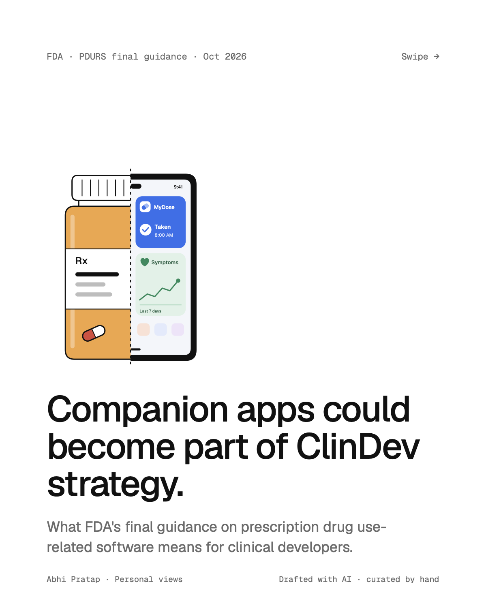
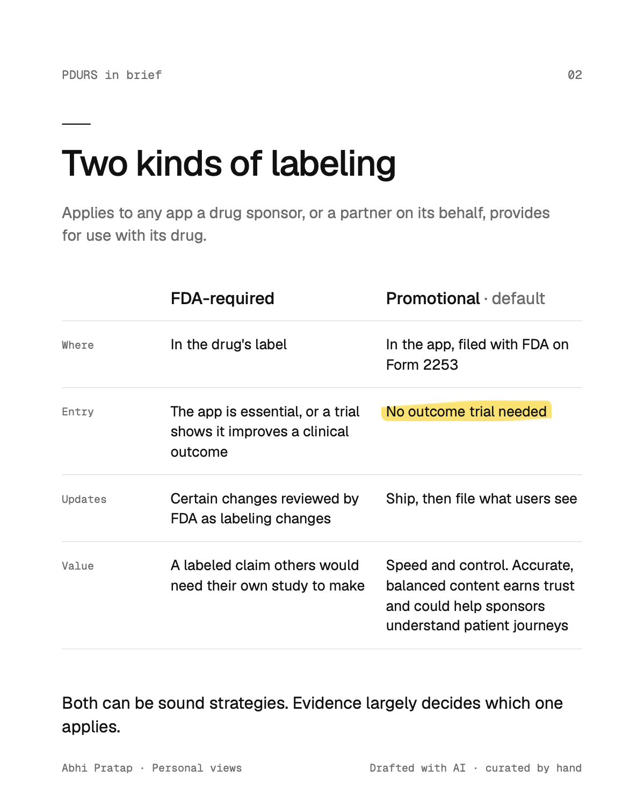
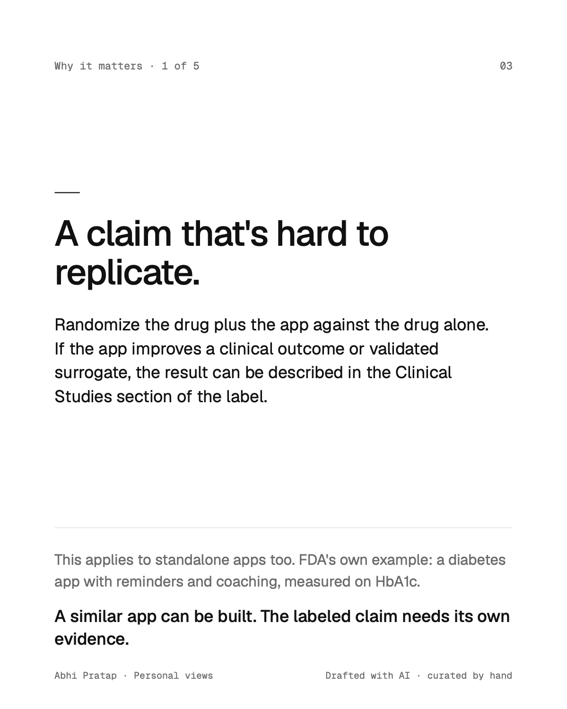
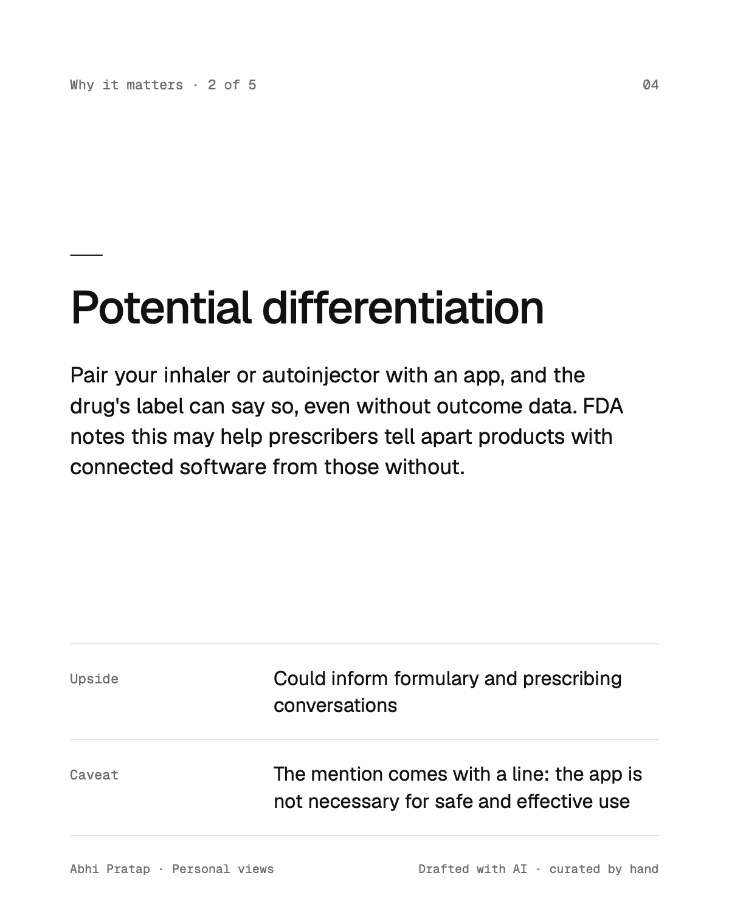
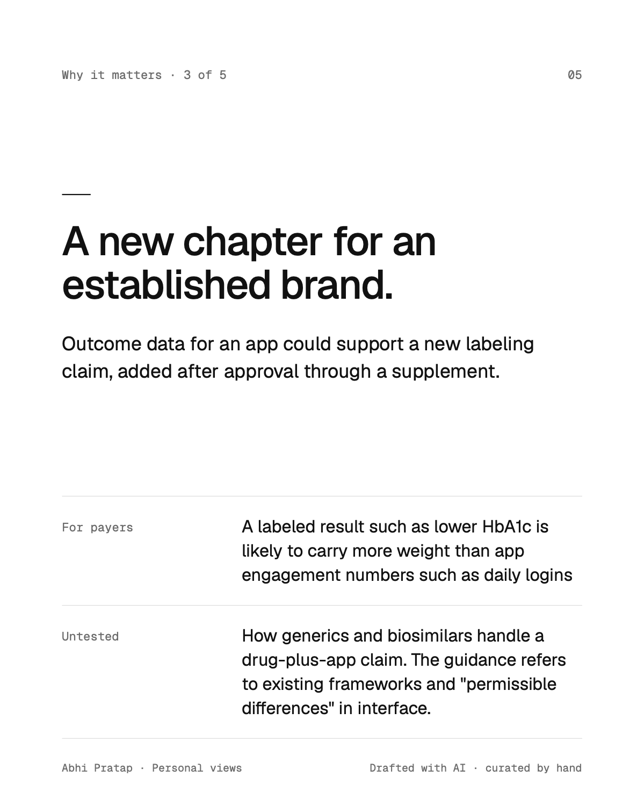
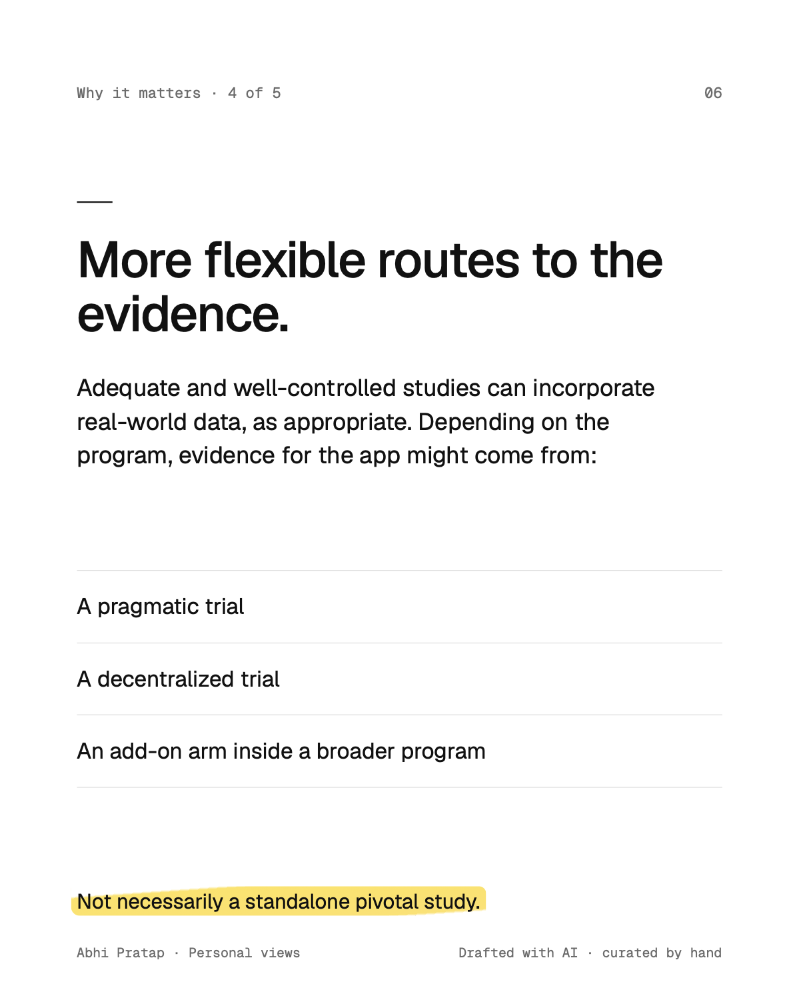
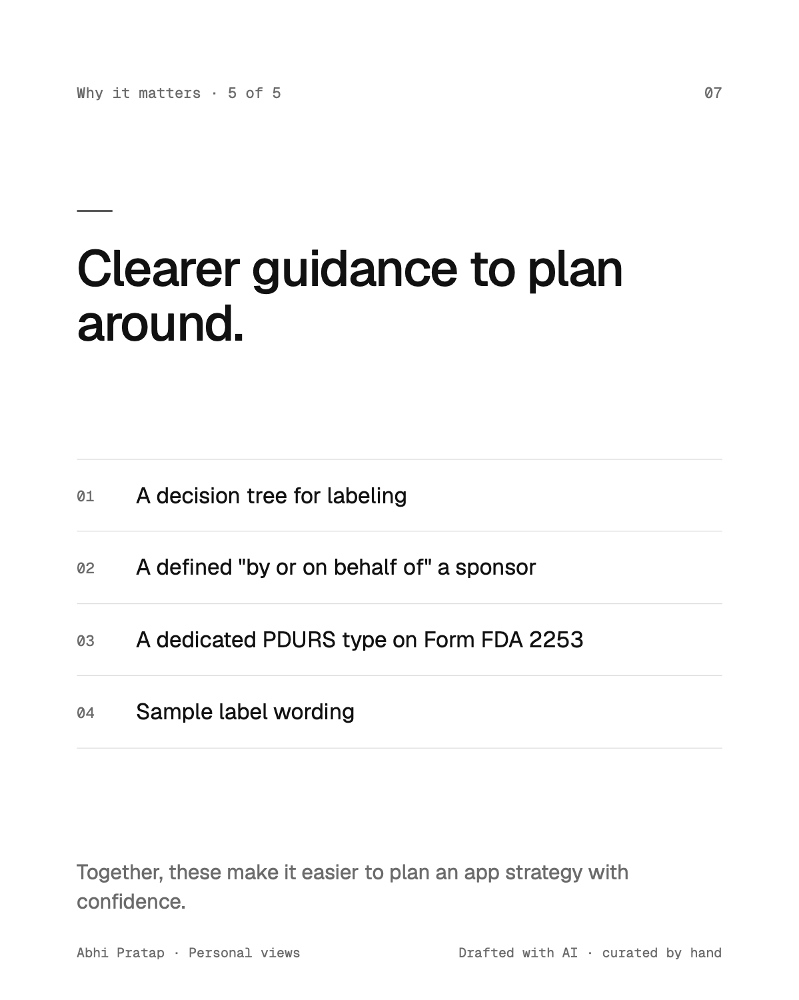
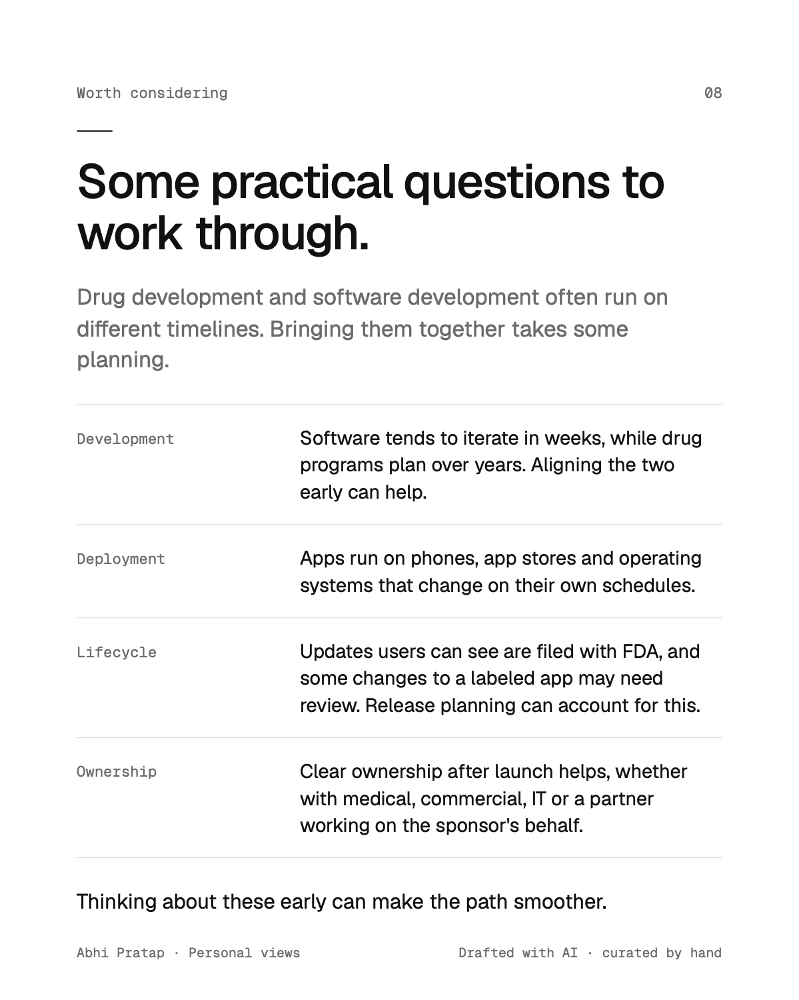
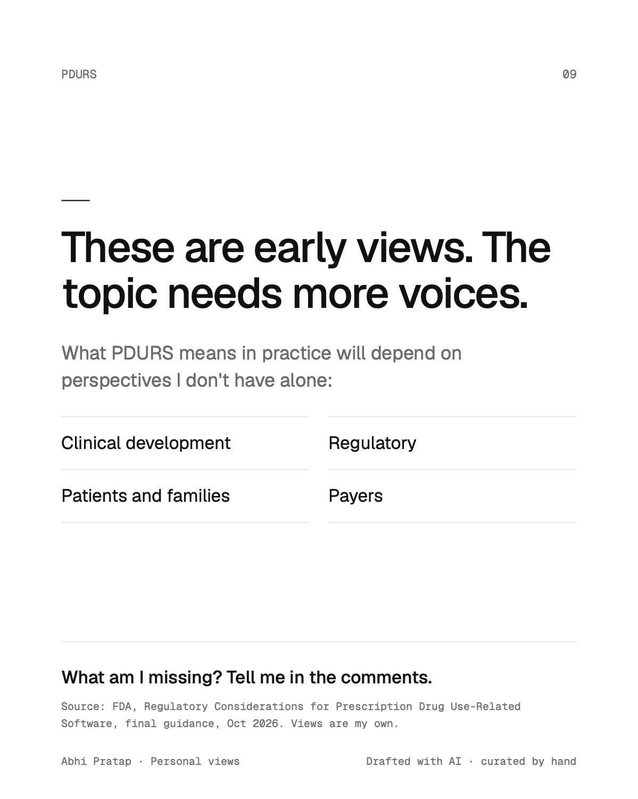

FDA has released its [final guidance on prescription drug use-related software (PDURS)](https://www.fda.gov/regulatory-information/search-fda-guidance-documents/regulatory-considerations-prescription-drug-use-related-software).

**The short version:** FDA acknowledges that

> "…various software … mobile apps … may have a variety of health-related uses, such as assisting patients
> with tracking their own drug administration, providing individualized dosing recommendations, predicting
> treatment response, and managing side effects…"

So what does this mean? Sponsor-provided "companion apps" that show benefit to patients and clinicians count
as drug labeling, either FDA-required or promotional.

This may open some interesting questions about where companion apps fit in evidence planning, and how they
might evolve over a drug's lifecycle.

I put together a few early thoughts in the slides below (*and, admittedly, AI is getting suspiciously good at
turning my thoughts into slides*).

<!-- Slides: one image per PDF page in slides/, the original PDF alongside. -->
```{=html}
<figure class="slide-carousel" aria-roledescription="carousel" aria-label="Slides: FDA final PDURS guidance">
  <div class="slide-track" tabindex="0">
    
    
    
    
    
    
    
    
    
  </div>
  <figcaption class="slide-controls">
    <button type="button" class="carousel-btn" data-dir="-1" aria-label="Previous slide">←</button>
    <span class="slide-count" aria-live="polite">1 / 9</span>
    <button type="button" class="carousel-btn" data-dir="1" aria-label="Next slide">→</button>
    <a class="slide-download" href="pdurs-slides.pdf" download>download pdf</a>
  </figcaption>
</figure>

<script>
// Slide carousel: arrows, arrow keys and swipe move one slide; the counter follows the scroll.
document.querySelectorAll(".slide-carousel").forEach((box) => {
  const track = box.querySelector(".slide-track");
  const count = box.querySelector(".slide-count");
  const [prev, next] = box.querySelectorAll(".carousel-btn");
  const total = track.children.length;
  let target = null, settle;  // slide being scrolled to, so quick repeat clicks keep counting
  const current = () => target ?? Math.round(track.scrollLeft / track.clientWidth);
  const go = (i) => {
    target = Math.max(0, Math.min(total - 1, i));
    track.scrollTo({ left: target * track.clientWidth, behavior: "smooth" });
  };
  const update = () => {
    clearTimeout(settle);
    settle = setTimeout(() => { target = null; }, 150);
    const i = Math.round(track.scrollLeft / track.clientWidth);
    count.textContent = `${i + 1} / ${total}`;
    prev.disabled = i === 0;
    next.disabled = i === total - 1;
  };
  box.addEventListener("click", (e) => {
    const btn = e.target.closest(".carousel-btn");
    if (btn) go(current() + Number(btn.dataset.dir));
  });
  track.addEventListener("keydown", (e) => {
    if (e.key === "ArrowRight") { e.preventDefault(); go(current() + 1); }
    if (e.key === "ArrowLeft") { e.preventDefault(); go(current() - 1); }
  });
  track.addEventListener("scroll", update, { passive: true });
  update();
});
</script>
```

This topic would benefit from many perspectives: clinical development, regulatory, patients and families, and
payers. What am I missing? I'd welcome your views; you can reach me on
[LinkedIn](https://www.linkedin.com/in/abhishekpratap/).

*Views are my own.*
