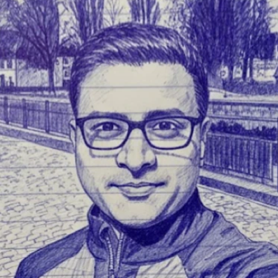

::: {.home}

::: {.home-index}

::: {.profile}
::: {.profile-id}
{.avatar fig-alt="Abhishek (Abhi) Pratap"}

## Abhishek (Abhi) Pratap
:::

Global Head of Medicine, Digital Health Technologies at Boehringer Ingelheim. Clinical R&D and
technology leader with 15+ years designing and running clinical trials and building digital and AI tools
that measure outcomes that matter to patients and families.

::: {.appointments}
[Academic appointments]{.label}

- Adjunct Associate Professor, University of Washington
- Research Assistant Professor, Boston University
- Visiting Research Fellow, King's College London
:::

[[writing](blog/index.qmd) · [papers](papers.qmd) · [aid4mh](aid4mh/index.qmd) · [about](about.qmd) · [linkedin](https://www.linkedin.com/in/abhishekpratap/)]{.label-links}

[Views are my own.]{.handnote}
:::

::: {.index-main}
[Current focus]{.label}

<!-- Update whenever it changes. -->
::: {.now-list}
- De-risking late-stage trials with AI: an analytics engine that pressure-tests design and execution
  scenarios, and fit-for-purpose agents that keep protocols grounded in real-world patient journeys.
- Embedding digital health technologies in late-stage trials: reaching the right patients, faster and more
  precise screening, and endpoints that reflect daily function.
:::

::: {.pinned-block}
[Pinned]{.label}

::: {#pinned}
:::
:::

[Selected papers]{.label}

<!-- Hand-picked from the CV; edit freely. Authors shortened to first 3, …, last 3; each ends with a link. -->
::: {.selected-papers}
1. **Pratap A**, Lakhan SE, Snipes C, et al. A Digital Therapeutic Intervention for Negative Symptoms of
   Schizophrenia: A Randomized Clinical Trial. JAMA Netw Open. 2026;9(9):e2635753.
   doi:10.1001/jamanetworkopen.2026.35753 [link](https://doi.org/10.1001/jamanetworkopen.2026.35753){.paper-link}
2. Lakhan SE, Dorner-Ciossek C, …, Fernandez JW, von der Goltz C, **Pratap A**.
   Effectiveness, Engagement, and Safety of a Digital Therapeutic (CT-155/BI 3972080) for Treating Negative
   Symptoms in Schizophrenia: Protocol for the Phase 3 CONVOKE RCT. JMIR Res Protoc 2025;14:e81293.
   [link](https://doi.org/10.2196/81293){.paper-link}
3. Gandhi A, Firmin RL, …, Strauss GP, Dorner-Ciossek C, **Pratap A**. Patient Perspectives on a Digital
   Therapeutic for Schizophrenia: A Qualitative Evaluation of an App for Negative Symptoms. Schizophrenia
   Bulletin Open, 6(1), 2025. [link](https://doi.org/10.1093/schizbullopen/sgaf028){.paper-link}
4. Zhang Y, Folarin AA, Ranjan Y, …, Hotopf M, Dobson RJB, **Pratap A** & RADAR-CNS consortium. Assessing seasonal and weather effects on depression and
   physical activity using mobile health data. npj Mental Health Res 4, 11 (2025).
   [link](https://doi.org/10.1038/s44184-025-00125-x){.paper-link}
5. **Pratap A**, Neto EC, Snyder P, …, Heagerty P, Arean P, Omberg L. Indicators of retention in remote digital health
   studies: A cross-study evaluation of 100,000 participants. npj Digital Medicine 3, 21 (2020).
   [link](https://doi.org/10.1038/s41746-020-0224-8){.paper-link}
:::

[All papers →](papers.qmd){.more}
:::

:::

::: {.home-cards}
::: {.cards-head}
[Recent writing]{.label}

```{=html}
<div class="carousel-nav">
  <button type="button" class="carousel-btn" data-dir="-1" aria-label="Previous posts">←</button>
  <button type="button" class="carousel-btn" data-dir="1" aria-label="Next posts">→</button>
</div>
```
:::

::: {#recent}
:::

[All posts →](blog/index.qmd){.more}
:::

:::

```{=html}
<script>
// Recent writing: arrows slide the card row one card at a time.
document.addEventListener("DOMContentLoaded", () => {
  const row = document.querySelector("#listing-recent .list");
  const nav = document.querySelector(".carousel-nav");
  if (!row || !nav) return;
  const [prev, next] = nav.querySelectorAll(".carousel-btn");
  const step = () => {
    const card = row.firstElementChild;
    return card ? card.getBoundingClientRect().width + parseFloat(getComputedStyle(row).columnGap || 0) : row.clientWidth;
  };
  const update = () => {
    const max = row.scrollWidth - row.clientWidth;
    nav.hidden = max <= 1;
    prev.disabled = row.scrollLeft <= 1;
    next.disabled = row.scrollLeft >= max - 1;
  };
  nav.addEventListener("click", (e) => {
    const btn = e.target.closest(".carousel-btn");
    if (btn) row.scrollBy({ left: step() * Number(btn.dataset.dir), behavior: "smooth" });
  });
  row.addEventListener("scroll", update, { passive: true });
  window.addEventListener("resize", update);
  update();
});
</script>
```
